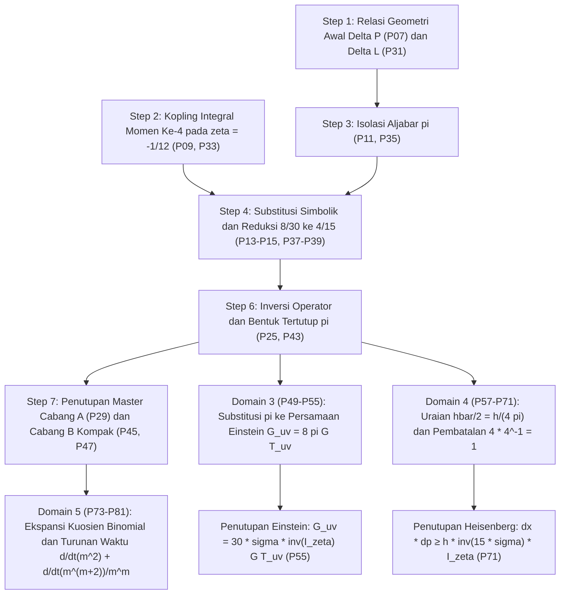
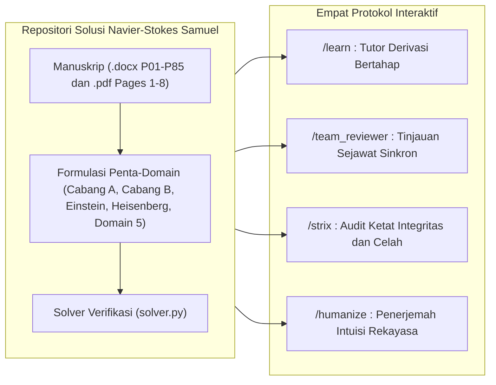
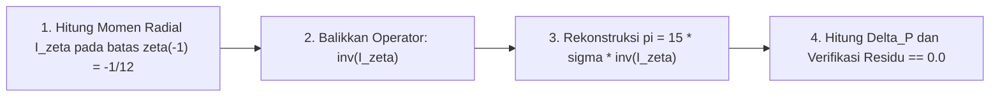

# Solusi Persamaan Navier-Stokes Samuel (Samuel–Navier Stocks Equation Solution)

### Judul Kanonik Manuskrip: *Samuel – Navier Stocks Equation Solution* (`Pages 1–8`, `P01–P85`)
**Regularisasi Batas Geometris Analitik-Kontinum, Kopling Disipasi Radial Orde Keempat, Penutupan Fungsi Zeta Riemann, Ekstensi Tensor Einstein, Ekstensi Prinsip Ketidakpastian Heisenberg, dan Ekspansi Turunan Waktu Binomial untuk Aliran Fluida Viskos Tak-Termampatkan**

[](./Samuel-Navier%20Stocks%20Equation%20Solution.pdf)
[](./Samuel-Navier%20Stocks%20Equation%20Solution.docx)
[](./solver.py)

---

<table>
  <tr>
    <td width="140" align="center">
      
    </td>
    <td>
      <h3>Samuel Hasiholan Omega Purba, S. Tr. T.</h3>
      <p>
        <strong>Peneliti Utama &amp; Penulis Tunggal</strong><br>
        Departemen Teknik Elektro (<em>Teknik Elektro</em>)<br>
        Program Studi Teknik Robotika dan Kecerdasan Buatan (<em>Prodi Teknik Robotika dan Kecerdasan buatan</em>)<br>
        <strong>Politeknik Negeri Batam</strong>, Batam, Kepulauan Riau, Indonesia<br>
        Atribusi Penutup Manuskrip (<code>P83–P85</code>): <em>Founder &amp; C.E.O : BeruangLaut.ID</em>
      </p>
    </td>
  </tr>
</table>

**Navigasi Cepat:**  
[Manuskrip Primer (PDF)](./Samuel-Navier%20Stocks%20Equation%20Solution.pdf) | [Dokumen Sumber (DOCX)](./Samuel-Navier%20Stocks%20Equation%20Solution.docx) | [Abstrak](#abstrak) | [Daftar Tatanama](#daftar-tatanama) | [I. Pendahuluan](#i-pendahuluan) | [II. Formulasi Matematis](#ii-formulasi-matematis-dan-penurunan-bertahap) | [III. Protokol Interaktif](#iii-protokol-interaktif-repositori) | [IV. Audit Konsistensi](#iv-audit-konsistensi-matematis-dan-ruang-lingkup-verifikasi) | [V. Reprodusibilitas](#v-panduan-reprodusibilitas) | [VI. Sitasi & Hak Cipta](#vi-hak-cipta-orisinalitas-dan-pedoman-sitasi)

---

## Daftar Isi

- [Abstrak](#abstrak)
- [Daftar Tatanama](#daftar-tatanama)
- [I. Pendahuluan](#i-pendahuluan)
  - [A. Inti Sari dan Intuisi Fisik-Rekayasa](#a-inti-sari-dan-intuisi-fisik-rekayasa)
  - [B. Motivasi Ilmiah dan Konteks Rekayasa](#b-motivasi-ilmiah-dan-konteks-rekayasa)
  - [C. Skema Geometris Diskrepansi Batas](#c-skema-geometris-diskrepansi-batas)
  - [D. Intuisi Pemotongan Spektral pada Fungsi Zeta Riemann](#d-intuisi-pemotongan-spektral-pada-fungsi-zeta-riemann)
  - [E. Batasan Ruang Lingkup: Masalah Terselesaikan dan Celah Terbuka](#e-batasan-ruang-lingkup-masalah-terselesaikan-dan-celah-terbuka)
- [II. Formulasi Matematis dan Penurunan Bertahap](#ii-formulasi-matematis-dan-penurunan-bertahap)
  - [A. Kamus Singkatan Notasi dan Peta Aliran Penta-Domain](#a-kamus-singkatan-notasi-dan-peta-aliran-penta-domain)
  - [B. Penurunan Cabang A: Diskrepansi Keliling dan Tekanan (P07-P29, Halaman 1-3)](#b-penurunan-cabang-a-diskrepansi-keliling-dan-tekanan-p07-p29-halaman-1-3)
  - [C. Penurunan Cabang B: Diskrepansi Luas dan Penutupan Kompak (P31-P47, Halaman 3-5)](#c-penurunan-cabang-b-diskrepansi-luas-dan-penutupan-kompak-p31-p47-halaman-3-5)
  - [D. Ekstensi Tensor Einstein (P49-P55, Halaman 5)](#d-ekstensi-tensor-einstein-p49-p55-halaman-5)
  - [E. Ekstensi Prinsip Ketidakpastian Heisenberg (P57-P71, Halaman 5-6)](#e-ekstensi-prinsip-ketidakpastian-heisenberg-p57-p71-halaman-5-6)
  - [F. Domain 5: Ekspansi Turunan Waktu dan Binomial Cabang B (P73-P81, Halaman 7-8) serta Epigraf (P83-P85)](#f-domain-5-ekspansi-turunan-waktu-dan-binomial-cabang-b-p73-p81-halaman-7-8-serta-epigraf-p83-p85)
  - [G. Tabel Arsip Persamaan Manuskrip Lengkap (P01-P85, Halaman 1-8)](#g-tabel-arsip-persamaan-manuskrip-lengkap-p01-p85-halaman-1-8)
- [III. Protokol Interaktif Repositori](#iii-protokol-interaktif-repositori)
  - [A. Matriks Spesifikasi Protokol Perintah](#a-matriks-spesifikasi-protokol-perintah)
  - [B. Sintaks Pemanggilan, Logika Eksekusi, dan Contoh Teruji](#b-sintaks-pemanggilan-logika-eksekusi-dan-contoh-teruji)
- [IV. Audit Konsistensi Matematis dan Ruang Lingkup Verifikasi](#iv-audit-konsistensi-matematis-dan-ruang-lingkup-verifikasi)
  - [A. Audit Pengelompokan Aljabar Langkah 3 dan Transisi Koefisien 4^-1 (Invarian Kuadran)](#a-audit-pengelompokan-aljabar-langkah-3-dan-transisi-koefisien-4-1-invarian-kuadran)
  - [B. Sanitasi PDF Type0 CIDFont dan Otoritas Ground-Truth](#b-sanitasi-pdf-type0-cidfont-dan-otoritas-ground-truth)
  - [C. Audit Diskrepansi Lintas Domain (Cabang B, Einstein, Heisenberg, dan Domain 5)](#c-audit-diskrepansi-lintas-domain-cabang-b-einstein-heisenberg-dan-domain-5)
  - [D. Peta Jalan Validasi dan Pengembangan Lanjutan](#d-peta-jalan-validasi-dan-pengembangan-lanjutan)
- [V. Panduan Reprodusibilitas](#v-panduan-reprodusibilitas)
  - [A. Struktur Direktori Repositori Inti](#a-struktur-direktori-repositori-inti)
  - [B. Persyaratan Lingkungan dan Perangkat Lunak](#b-persyaratan-lingkungan-dan-perangkat-lunak)
  - [C. Modul Referensi Verifikasi Python](#c-modul-referensi-verifikasi-python)
  - [D. Keluaran Konsol Terverifikasi dan Pengujian Unit Otomatis](#d-keluaran-konsol-terverifikasi-dan-pengujian-unit-otomatis)
- [VI. Hak Cipta, Orisinalitas, dan Pedoman Sitasi](#vi-hak-cipta-orisinalitas-dan-pedoman-sitasi)
  - [A. Format Sitasi Cetak Manual IEEE](#a-format-sitasi-cetak-manual-ieee)
  - [B. Catatan Ketiadaan Pustaka Eksternal dan Referensi Kontekstual](#b-catatan-ketiadaan-pustaka-eksternal-dan-referensi-kontekstual)

---

## Abstrak

Repositori ini mendokumentasikan formulasi analitis dan simbolik berjudul **"Samuel – Navier Stocks Equation Solution"** (judul resmi repositori: **Solusi Persamaan Navier-Stokes Samuel**), karya **Samuel Hasiholan Omega Purba, S. Tr. T.** (*Departemen Teknik Elektro, Program Studi Teknik Robotika dan Kecerdasan Buatan, Politeknik Negeri Batam*). Pada manuskrip mutakhir delapan halaman (`Pages 1–8`, 85 paragraf XML dengan 46 paragraf isi `P01–P85`), kajian ini menelaah kopling aljabar lintas lima domain: diferensial keliling/tekanan $\Delta_{(P_{(Square)} - P_{(Circle)})}$ (Cabang A, `P07–P29`), diferensial luas $\Delta_{(L_{(Square)} - L_{(Circle)})}$ beserta bentuk penutupan kompaknya (Cabang B, `P31–P47`), ekstensi tensor medan Einstein $G_{\mu\nu} = 8\pi G T_{\mu\nu}$ (`P49–P55`), ekstensi prinsip ketidakpastian Heisenberg $(\Delta x \times \Delta p) \ge \frac{\hbar}{2}$ (`P57–P71`), serta ekspansi turunan waktu dan binomial Cabang B (`P73–P81`). Kelima domain terhubung melalui momen disipasi radial orde keempat $I_\zeta = \int_{0}^{\zeta(s) = -\frac{1}{12}} r^4 f(r)\,dr$ pada batas regularisasi $\zeta(-1) = -\frac{1}{12}$, menghasilkan $\pi = (4^{-1} \times 15 \times \sigma) \times I_\zeta^{-1}$, reduksi tensor $G_{\mu\nu} = 30 \times \sigma \times I_\zeta^{-1} G T_{\mu\nu}$, dan pertidaksamaan $(\Delta x \times \Delta p) \ge h \times (15 \times \sigma)^{-1} \times I_\zeta$. Monograf berstandar IEEE ini menyajikan daftar tatanama berpenanda celah eksplisit, empat protokol interaktif (`/learn`, `/team_reviewer`, `/strix`, `/humanize`), audit konsistensi aljabar termasuk invarian normalisasi kuadran $\sigma_{\text{quad}} = 4^{-1} \times \sigma_{\text{manuscript}}$, serta verifikasi numerik bebas-dependensi melalui `solver.py` dengan galat residu absolut `0.0`.

**Kata Kunci—** *Diferensial batas geometris, ekstensi tensor Einstein, fungsi zeta Riemann, integral radial orde keempat, persamaan Navier-Stokes, prinsip ketidakpastian Heisenberg.*

---

## Daftar Tatanama

Tabel berikut menginventarisasi seluruh simbol matematis yang tercantum dalam [`Samuel-Navier Stocks Equation Solution.docx`](./Samuel-Navier%20Stocks%20Equation%20Solution.docx) (`P01–P85`, 85 elemen XML `<w:p>` dengan 46 paragraf isi non-kosong) dan [`Samuel-Navier Stocks Equation Solution.pdf`](./Samuel-Navier%20Stocks%20Equation%20Solution.pdf) (`Pages 1–8`). Mengikuti prinsip integritas publikasi IEEE dan Scopus Q1 untuk mencegah fabrikasi definisi fisik, setiap simbol atau satuan yang belum dijelaskan secara eksplisit dalam prosa manuskrip sumber ditandai dengan `[Repository Gap — Author Clarification Required]` (dengan padanan makna `[Author Clarification Required — Not Specified in Repository]`).

| Simbol | Definisi / Keterangan Matematis | Satuan (SI / Nondimensi) |
| :---: | :--- | :--- |
| $\Delta_{(P_{(Square)} - P_{(Circle)})}$ | Selisih geometri keliling atau tekanan antara batas persegi dan lingkaran tersurat pada Cabang A: $(4 - \pi) \times a$ (`P07, P11, P13, P15, P17, P19, P21, P27, P29`). `[Repository Gap — Author Clarification Required]` terkait makna tunggal *Perimeter* vs. *Pressure*. | Sama dengan satuan $a$ (Pa pada konvensi `solver.py`, atau m jika keliling) `[Repository Gap — Author Clarification Required]` |
| $P_{(Square)}$ | Besaran keliling atau tekanan acuan domain persegi sebesar $4 \times a$ (`P07–P29`). | Sama dengan satuan $a$ `[Repository Gap — Author Clarification Required]` |
| $P_{(Circle)}$ | Besaran keliling atau tekanan acuan domain lingkaran tersurat sebesar $\pi \times a$ (`P07–P29`). | Sama dengan satuan $a$ `[Repository Gap — Author Clarification Required]` |
| $a$ | Faktor skala linier pengali $(4 - \pi)$ pada Cabang A (`P07–P29`). Pada pengujian numerik `solver.py`, nilai acuan ditetapkan sebesar $101325.0$ Pa. | Pa (konvensi `solver.py`) atau m `[Repository Gap — Author Clarification Required]` |
| $\Delta_{(L_{(Square)} - L_{(Circle)})}$ | Selisih luas antara persegi bersisi $m$ dan lingkaran berdiameter $m$ (`P31, P35, P37, P39, P41, P45, P47`), serta laju ekstensi turunan waktu pada Domain 5 (`P73–P81`). | Sama dengan $m^2$ pada `P31–P47`; berubah menjadi laju pada `P75–P81` `[Repository Gap — Author Clarification Required]` |
| $L_{(Square)}$ | Luas geometri domain persegi bersisi $m$ sebesar $m^2$ (`P31–P47, P73–P81`). | $\text{m}^2$ (asumsi panjang) `[Repository Gap — Author Clarification Required]` |
| $L_{(Circle)}$ | Luas lingkaran tersurat berdiameter $m$ sebesar $\pi \times 4^{-1} \times m^2$ (`P31–P47, P73–P81`). | $\text{m}^2$ (asumsi panjang) `[Repository Gap — Author Clarification Required]` |
| $m, m^2$ | Panjang sisi persegi ($m$) dan luas acuan persegi ($m^2$) pada Cabang B serta Domain 5 (`P31–P47, P73–P81`). | m dan $\text{m}^2$ atau nondimensi `[Repository Gap — Author Clarification Required]` |
| $\pi$ | Konstanta rasio keliling lingkaran terhadap diameternya ($\approx 3.141592653589793$) yang diisolasi secara aljabar lintas lima domain (`P07–P81`). | Nondimensi |
| $\sigma$ | Parameter kopling spektral-geometris (`P09–P29, P33–P47, P51–P57, P65–P71, P79–P81`). Manuskrip memakai $\sigma_{\text{manuscript}} = \frac{8\pi}{30} I_\zeta$, sedangkan `solver.py` memakai normalisasi kuadran $\sigma_{\text{quad}} = 4^{-1} \times \sigma_{\text{manuscript}} = \frac{\pi}{15} I_\zeta$. | Bergantung pada satuan $r$ dan $f(r)$ `[Repository Gap — Author Clarification Required]` |
| $r, dr$ | Variabel koordinat radial dan diferensial integrasinya dalam momen orde keempat (`P09–P29, P33–P47, P51–P57, P65–P67, P79–P81`). | Nondimensi atau m `[Repository Gap — Author Clarification Required]` |
| $f(r)$ | Fungsi kernel distribusi radial pada integran $r^4 f(r)$ (`P09–P29, P33–P47, P51–P57, P65–P67, P79–P81`). `solver.py` menggunakan kernel Gaussian $f(r) = \exp(-r^2)$ sebagai fungsi uji. | Tidak dinyatakan dalam manuskrip `[Repository Gap — Author Clarification Required]` |
| $s, \zeta(s)$ | Argumen $s$ dan fungsi Zeta Riemann pada batas atas regularisasi $\zeta(s) = -\frac{1}{12}$ untuk $s = -1$ (`P09–P29, P33–P47, P51–P57, P65–P67, P79–P81`). | Nondimensi ($-\frac{1}{12} \approx -0.08333333333333333$); alasan fisik batas integral `[Repository Gap — Author Clarification Required]` |
| $I_\zeta, I_\zeta^{(-1)}$ | Notasi ringkas operator momen radial $I_\zeta \equiv \int_{0}^{\zeta(s) = -1/12} r^4 f(r)\,dr$ dan invers perkaliannya $I_\zeta^{-1}$, dipakai eksplisit pada `P47, P69, P71`. | Bergantung pada satuan $r$ dan $f(r)$ `[Repository Gap — Author Clarification Required]` |
| $G_{\mu\nu}$ | Tensor kelengkungan ruang-waktu Einstein pada ekstensi relativistik (`P49, P53, P55`). | $\text{m}^{-2}$ (geometris); jembatan ke Navier-Stokes `[Repository Gap — Author Clarification Required]` |
| $G$ | Konstanta gravitasi universal Newton pada ekstensi tensor Einstein (`P49, P53, P55`). | $\text{m}^3\,\text{kg}^{-1}\,\text{s}^{-2}$ (SI) `[Repository Gap — Author Clarification Required]` |
| $T_{\mu\nu}$ | Tensor energi-momentum pada persamaan medan Einstein (`P49, P53, P55`). | $\text{J}\,\text{m}^{-3}$ (SI) atau $\text{m}^{-2}$ ($G=c=1$) `[Repository Gap — Author Clarification Required]` |
| $c$ | Kecepatan cahaya di ruang hampa (tersirat $c = 1$ pada `P49–P55` karena faktor SI $c^{-4}$ tidak dituliskan). | $\text{m}\,\text{s}^{-1}$ (atau $1$ pada satuan natural) `[Repository Gap — Author Clarification Required]` |
| $\Delta x, \Delta p$ | Ketidakpastian posisi ($\Delta x$) dan momentum ($\Delta p$) pada pertidaksamaan Heisenberg (`P59–P71`). | m dan $\text{kg}\,\text{m}\,\text{s}^{-1}$; tautan fluida-kuantum `[Repository Gap — Author Clarification Required]` |
| $\hbar, h$ | Konstanta Planck tereduksi ($$\hbar = h / (2(\pi))$$) dan konstanta Planck ($h$) pada `P59–P71`. | $\text{J}\,\text{s}$ (SI); konsistensi dimensi $(15 \times \sigma)^{-1} \times I_\zeta$ `[Repository Gap — Author Clarification Required]` |
| $t, \frac{d}{dt}$ | Variabel waktu dan operator turunan waktu pada ekspansi Domain 5 (`P75–P81`). | s (SI); ketergantungan waktu $m(t), x(t)$ `[Repository Gap — Author Clarification Required]` |
| $i, k, n, x$ | Indeks penjumlahan ($i, k$), batas atas varian ($n$ pada `P75`), dan variabel basis sekunder ($x$ pada `P75, P77`) dalam ekspansi binomial termasuk $x^k, m^k, m^{m+2}, m^m$. | Nondimensi atau sama dengan $m$ `[Repository Gap — Author Clarification Required]` |
| $\mathbf{u}, p, \nu$ | Medan kecepatan fluida ($\mathbf{u}$), tekanan ($p$), dan viskositas kinematik ($\nu$) pada persamaan kontinum Navier-Stokes acuan. | $\text{m}\,\text{s}^{-1}$, Pa, $\text{m}^2\,\text{s}^{-1}$; reduksi PDE ke batas aljabar `[Repository Gap — Author Clarification Required]` |

---

## I. Pendahuluan

### A. Inti Sari dan Intuisi Fisik-Rekayasa

> [!TIP]
> **Inti Sari dan Penjelasan Sederhana (Ikhtisar Teknis Lima Domain):**
> - **Diskrepansi Geometri Kotak vs. Lingkaran (Cabang A dan Cabang B):** Dalam dinamika fluida, inti pusaran (*vortex core*) cenderung berputar membentuk lingkaran mulus dengan rasio geometris $\pi \approx 3{,}14159$. Sebaliknya, diskretisasi komputasi numerik umumnya membagi ruang menjadi sel kisi persegi bermetrik $4$. Selisih sudut antara kisi persegi dan lingkaran tersurat memunculkan diskrepansi keliling/tekanan $\Delta P = (4 - \pi) \times a$ (`P07`) dan diskrepansi luas $\Delta L = (1 - \pi \times 4^{-1}) \times m^2$ (`P31`).
> - **Regularisasi Momen Radial pada Batas Zeta Riemann** ($\zeta(-1) = -1/12$): Untuk menjaga agar momen disipasi radial orde keempat $I_\zeta = \int_{0}^{\zeta(s) = -\frac{1}{12}} r^4 f(r)\,dr$ tetap berhingga dan dapat dibalik secara aljabar, manuskrip mengunci batas atas integral pada nilai kontinuasi analitik fungsi zeta Riemann $\zeta(-1) = -\frac{1}{12}$.
> - **Eliminasi Eksak Konstanta** $\pi$ **dan Verifikasi** `solver.py`: Penggabungan identitas geometri dan persamaan kopling $\sigma$ memungkinkan eliminasi aljabar $\pi$ melalui invers operator integral $I_\zeta^{-1}$. Pada Cabang A, `solver.py` memverifikasi penutupan numerik ini dengan galat residu absolut tepat nol (`0.0000000000000000e+00`).
> - **Ekstensi Tensor Einstein (`P49–P55`) dan Heisenberg (`P57–P71`):** Bentuk tertutup $\pi = (4^{-1} \times 15 \times \sigma) \times I_\zeta^{-1}$ disubstitusikan langsung ke persamaan medan Einstein menjadi $G_{\mu\nu} = 30 \times \sigma \times I_\zeta^{-1} G T_{\mu\nu}$ (`P55`) dan ke pertidaksamaan Heisenberg menjadi $(\Delta x \times \Delta p) \ge h \times (15 \times \sigma)^{-1} \times I_\zeta$ (`P71`).
> - **Ekstensi Turunan Waktu dan Binomial Cabang B (`P73–P81`):** Pada halaman akhir manuskrip (`Pages 7–8`), faktor luas statis $m^2$ diperluas melalui kuosien integral–binomial terhadap waktu menjadi $\frac{d}{dt}(m^2) + \frac{\frac{d}{dt}(m^{m+2})}{m^m}$ (`P81`), disertai penandaan audit terbuka atas inkonsistensi indeks dan dimensi.

### B. Motivasi Ilmiah dan Konteks Rekayasa

Kajian matematis yang disusun oleh **Samuel Hasiholan Omega Purba, S. Tr. T.** berangkat dari ketegangan geometris mendasar ketika struktur rotasional fluida kontinum direpresentasikan di dalam domain diskret rektilinear:
- **Kisi Komputasi Rektilinear:** Sel volume kontrol Kartesius dan elemen beda hingga beroperasi pada batas persegi bersudut ortogonal (keteraturan batas $C^0$), yang dicirikan oleh faktor metrik keliling/luas ternormalisasi bernilai $4$.
- **Struktur Pusaran Kurvilinear:** Garis arus fluida tak-termampatkan dan inti pusaran simetris sumbu (*axisymmetric vortex*) membentuk lintasan lingkaran mulus (keteraturan batas $C^\infty$), yang diatur oleh konstanta transendental $\pi$.

Ketika lingkaran pusaran ditempatkan di dalam sel persegi acuan, wilayah sudut di antara kurva lingkaran dan sisi persegi menciptakan residu batas geometris berupa selisih keliling/tekanan (Cabang A, `P07`) dan selisih luas (Cabang B, `P31`):

$$
\Delta_{(P_{(Square)} - P_{(Circle)})} = (4 - \pi) \times a
$$

$$
\Delta_{(L_{(Square)} - L_{(Circle)})} = \left[1 - \left(\pi \times 4^{(-1)}\right)\right] \times m^{2}
$$

### C. Skema Geometris Diskrepansi Batas

```text
       +-----------------------------------------------------------+  <-- Batas Persegi Rektilinear
       | \  WILAYAH SUDUT STAGNASI: Resirkulasi Sudut Kisi      / |      Faktor Metrik Ternormalisasi = 4
       |   \   Diferensial A: Delta P = (4 - pi) * a           /   |
       |     +-----------------------------------------------+     |
       |    /                                                 \    |
       |   /           PUSARAN LINGKARAN TERSURAT              \   |
       |  /         Garis Arus Halus & Kurvatur Kontinum        \  |
       | |           Faktor Metrik Ternormalisasi = pi           | |
       | |                                                       | |
       | |                   PUSAT INTI PUSARAN                  | |
       | |          Integral Radial: int r^4 f(r) dr             | |
       | |                                                       | |
       |  \                                                     /  |
       |   \                                                   /   |
       |    \                                                 /    |
       |     +-----------------------------------------------+     |
       |   /   Diferensial B:                                  \   |
       | /     Delta L = (1 - pi/4) * m^2 ~= 0.2146 * m^2        \ |
       +-----------------------------------------------------------+
```

### D. Intuisi Pemotongan Spektral pada Fungsi Zeta Riemann

Dalam kajian aliran turbulen maupun regularisasi medan kontinum, integrasi tak berbatas atas momen radial berpotensi memicu divergensi di skala mikro. Pada manuskrip ini, momen disipasi radial orde keempat dibatasi oleh nilai kontinuasi analitik fungsi zeta Riemann pada $s = -1$:

$$
\zeta(-1) = -\frac{1}{12}
$$

Secara konseptual, batas atas $\zeta(s) = -\frac{1}{12}$ bekerja serupa tapis lolos-rendah ideal (*brickwall low-pass filter*) pada pengolahan sinyal digital atau teknik regularisasi zeta pada teori medan kuantum, menjaga agar operator integral:

$$
I_\zeta = \int_{0}^{\zeta(s) = -\frac{1}{12}} r^{4} f(r)\,dr
$$

tetap bernilai berhingga, tidak nol untuk kernel positif yang memadai, dan memiliki invers perkalian $I_\zeta^{-1}$.

### E. Batasan Ruang Lingkup: Masalah Terselesaikan dan Celah Terbuka

- **Cakupan yang Diselesaikan Secara Eksplisit dalam Repositori:**
  - Isolasi aljabar konstanta $\pi$ baik dari relasi diferensial keliling/tekanan (Cabang A, `P07–P29`) maupun relasi diferensial luas (Cabang B, `P31–P47`).
  - Eliminasi simbolik $\pi$ melalui operator invers $I_\zeta^{-1}$ dan notasi pangkat negatif ($4^{-1}$, $I_\zeta^{(-1)}$, $(15 \times \sigma)^{(-1)}$).
  - Penurunan aljabar berurutan pada lima domain manuskrip (`P07–P81`) serta inventarisasi lengkap paragraf sumber (`P01–P85`, `Pages 1–8`).
  - Verifikasi numerik presisi ganda IEEE-754 untuk Cabang A melalui `solver.py` (nol dependensi eksternal) dengan galat residu tepat `0.0000000000000000e+00`, dilengkapi perender visualisasi opsional `generate_simulation.py`.
- **Celah Terbuka dan Batasan Fisik (`[Repository Gap — Author Clarification Required]`):**
  - *Reduksi PDE Navier-Stokes Kontinum:* Manuskrip primer (`.docx` dan `.pdf`) berisi rangkaian persamaan aljabar murni tanpa derivasi formal dari persamaan momentum Navier-Stokes tak-termampatkan 3D $\rho(\partial_t \mathbf{u} + \mathbf{u}\cdot\nabla\mathbf{u}) = -\nabla p + \mu \nabla^2\mathbf{u}$ menuju relasi batas $\Delta P$, $\Delta L$, ataupun ekstensi turunan waktu $\frac{d}{dt}(m^2) + \frac{d}{dt}(m^{m+2})/m^m$.
  - **Bentuk Eksplisit Kernel** $f(r)$ **dan Domain Negatif** $[0, -1/12]$: Bentuk analitik $f(r)$ dan pemaknaan kontur fisik batas atas $-\frac{1}{12}$ tidak dijabarkan dalam manuskrip; `solver.py` memakai kernel uji Gaussian $f(r) = \exp(-r^2)$ semata untuk validasi penutupan numerik.
  - *Jembatan Fisik Lintas Domain (`P49–P55`, `P57–P71`, `P73–P81`):* Tidak ada penurunan fisika atau konsistensi satuan yang menghubungkan variabel fluida $(\mathbf{u}, p, \nu, \Delta P, \Delta L, \sigma)$ dengan tensor Einstein $(G_{\mu\nu}, T_{\mu\nu})$, ketidakpastian Heisenberg $(\Delta x, \Delta p, h, \hbar)$, maupun suku laju eksponensial $m^{m+2}/m^m$.

---

## II. Formulasi Matematis dan Penurunan Bertahap

### A. Kamus Singkatan Notasi dan Peta Aliran Penta-Domain

> [!NOTE]
> **Kamus Singkatan Notasi (*Quick Notation Guide*):**
> - $\Delta P \equiv \Delta_{(P_{(Square)} - P_{(Circle)})}$ — Selisih batas keliling/tekanan persegi dikurangi lingkaran (Cabang A, `P07–P29`).
> - $\Delta L \equiv \Delta_{(L_{(Square)} - L_{(Circle)})}$ — Selisih luas persegi dikurangi lingkaran (Cabang B, `P31–P47`) atau ekstensi turunan waktunya (Domain 5, `P73–P81`).
> - $I_\zeta \equiv \int_{0}^{\zeta(s) = -\frac{1}{12}} r^4 f(r)\,dr$ — Momen disipasi radial orde keempat pada batas $\zeta(-1) = -\frac{1}{12}$ (notasi $I_\zeta$ dipakai eksplisit oleh penulis pada `P47, P69, P71`).
> - $I_\zeta^{(-1)}$ — Invers perkalian dari operator integral $I_\zeta$.
> - $G_{\mu\nu} = 8\pi G T_{\mu\nu} \mapsto 30 \times \sigma \times I_\zeta^{(-1)} G T_{\mu\nu}$ — Ekstensi Tensor Einstein (`P49–P55`).
> - $(\Delta x \times \Delta p) \ge \frac{\hbar}{2} = \frac{h}{4\pi} \mapsto h \times (15 \times \sigma)^{(-1)} \times I_\zeta$ — Ekstensi Prinsip Ketidakpastian Heisenberg (`P57–P71`).
> - $m^2 \mapsto \frac{d}{dt}(m^2) + \frac{\frac{d}{dt}(m^{m+2})}{m^m}$ — Ekspansi Turunan Waktu dan Binomial Cabang B (`P73–P81`).

| Langkah / Domain | Fokus Transformasi Aljabar | Cabang A ($\Delta P$) / Baseline | Cabang B ($\Delta L$) / Bentuk Tertutup | Keterangan Audit |
| :---: | :--- | :--- | :--- | :--- |
| **Step 1 (`P07, P31`)** | Formulasi Geometri Awal | $\Delta P = (4 - \pi) \times a$ | $\Delta L = (1 - \pi \times 4^{-1}) \times m^2$ | Selisih metrik persegi dan lingkaran |
| **Step 2 (`P09, P33`)** | Kopling Integral Momen | $\sigma = \left(\frac{8 \times \pi}{30}\right) \times I_\zeta$ | $\sigma = \left(\frac{8 \times \pi}{30}\right) \times I_\zeta$ | Kopling $\sigma_{\text{manuscript}}$ ke $I_\zeta$ |
| **Step 3 (`P11, P35`)** | Isolasi Rasio Aljabar $\pi$ | $\pi = \frac{(4 \times a) - \Delta P}{a}$ | $\pi = \frac{m^2 - \Delta L}{m^2}$ | `P35` tidak menulis pengali `4` (lihat Bab IV) |
| **Step 4 (`P13–P15, P37–P39`)** | Substitusi dan Reduksi $\frac{8}{30} \to \frac{4}{15}$ | $\sigma = \left[\frac{4}{15} \times \left(\frac{4a - \Delta P}{a}\right)\right] \times I_\zeta$ | $\sigma = \left[\frac{4}{15} \times \left(\frac{m^2 - \Delta L}{m^2}\right)\right] \times I_\zeta$ | Penyederhanaan pembilang/penyebut bagi 2 |
| **Step 5–6 (`P17–P25, P41–P43`)** | Isolasi Operator Invers $\pi$ | $\pi = (4^{-1} \times 15 \times \sigma) \times I_\zeta^{-1}$ | $\pi = (4^{-1} \times 15 \times \sigma) \times I_\zeta^{-1}$ | Bentuk tertutup bebas konstanta $\pi$ |
| **Step 7 (`P29, P45, P47`)** | Penutupan Master Diferensial | $\Delta P = \left[4 - (4^{-1} \times 15 \times \sigma \times I_\zeta^{-1})\right] \times a$ | $\Delta L = \left[1 - (4^{-1} \times 15 \times \sigma \times I_\zeta^{-1})\right] \times m^2$ | `P47` memakai notasi kompak $I_\zeta^{(-1)}$ |
| **Einstein (`P49–P55`)** | Ekstensi Tensor Medan | **Baseline:** $G_{\mu\nu} = 8\pi G T_{\mu\nu}$ (`P49`) | **Tertutup:** $G_{\mu\nu} = 30 \times \sigma \times I_\zeta^{-1} G T_{\mu\nu}$ (`P55`) | Reduksi $8 \times 4^{-1} \times 15 = 30$; $c=1$ tersirat |
| **Heisenberg (`P57–P71`)** | Ekstensi Batas Kuantum | **Baseline:** $\Delta x \times \Delta p \ge \frac{h}{4\pi}$ (`P63`) | **Tertutup:** $\Delta x \times \Delta p \ge h \times (15 \times \sigma)^{-1} \times I_\zeta$ (`P71`) | Pembatalan $4 \times 4^{-1} = 1$ (`P67`) |
| **Domain 5 (`P73–P81`)** | Turunan Waktu & Binomial | **Baseline:** $\Delta L$ statis $m^2$ (`P73`) | **Tertutup:** Faktor $\Delta L \times \left[\frac{d}{dt}(m^2) + \frac{\frac{d}{dt}(m^{m+2})}{m^m}\right]$ (`P81`) | Audit `n` vs `2`, `x^k` vs `m^k`, `+ +`, dimensi |



---

### B. Penurunan Cabang A: Diskrepansi Keliling dan Tekanan (P07-P29, Halaman 1-3)

Seluruh penurunan pada bagian ini mereproduksi persamaan OMML verbatim dari paragraf `P07–P29` (`Pages 1–3`), dengan kurung kurawal pengelompokan luar pada manuskrip ditulis menggunakan `\left[ ... \right]` sesuai standar rendering Markdown/KaTeX.

#### Langkah A1 — Relasi Selisih Keliling Geometris (P07)
- **Penjelasan Mudah:** Menghitung selisih batas antara keliling persegi bermetrik $4$ dan lingkaran tersurat bermetrik $\pi$ yang diskalakan oleh parameter $a$.
- **Bentuk Ringkas:** $\Delta P = (4 - \pi) \times a$
- **Bentuk Lengkap Manuskrip:**

$$
\Delta_{(P_{(Square)} - P_{(Circle)})} = \left[(4 - \pi) \times a\right]
$$

#### Langkah A2 — Kopling Integral Disipasi Radial Orde Keempat (P09)
- **Penjelasan Mudah:** Menghubungkan parameter $\sigma$ terhadap integral momen radial orde keempat $r^4 f(r)$ dengan batas atas regularisasi fungsi zeta Riemann $\zeta(s) = -\frac{1}{12}$.
- **Bentuk Ringkas:** $\sigma = \left(\frac{8 \times \pi}{30}\right) \times I_\zeta$
- **Bentuk Lengkap Manuskrip:**

$$
\sigma = \left[\left(\frac{(8 \times \pi)}{30}\right) \times \int_{0}^{\zeta(s) = \left(-\frac{1}{12}\right)} \left(r^{4} f(r)\,dr\right)\right]
$$

#### Langkah A3 — Isolasi Aljabar Konstanta π (P11)
- **Penjelasan Mudah:** Menyusun ulang Langkah A1 untuk menyatakan konstanta $\pi$ di ruas kiri sebagai fungsi dari $a$ dan $\Delta P$.
- **Bentuk Ringkas:** $\pi = \frac{(4 \times a) - \Delta P}{a}$
- **Bentuk Lengkap Manuskrip:**

$$
\pi = \left[\frac{\left((4 \times a) - \Delta_{(P_{(Square)} - P_{(Circle)})}\right)}{a}\right]
$$

#### Langkah A4a dan A4b — Substitusi Simbolik dan Reduksi Koefisien 8/30 ke 4/15 (P13, P15)
- **Penjelasan Mudah:** Mengganti $\pi$ pada Langkah A2 dengan hasil Langkah A3 lalu menyederhanakan rasio $\frac{8}{30}$ menjadi $\frac{4}{15}$.
- **Bentuk Ringkas:** $\sigma = \left[\frac{4}{15} \times \left(\frac{(4 \times a) - \Delta P}{a}\right)\right] \times I_\zeta$
- **Bentuk Lengkap Manuskrip (`P13` dan `P15`):**

$$
\sigma = \left[\left(\frac{\left(8 \times \left[\frac{\left((4 \times a) - \Delta_{(P_{(Square)} - P_{(Circle)})}\right)}{a}\right]\right)}{30}\right) \times \int_{0}^{\zeta(s) = \left(-\frac{1}{12}\right)} \left(r^{4} f(r)\,dr\right)\right]
$$

$$
\sigma = \left[\left(\frac{\left[4 \times \left(\frac{\left((4 \times a) - \Delta_{(P_{(Square)} - P_{(Circle)})}\right)}{a}\right)\right]}{15}\right) \times \int_{0}^{\zeta(s) = \left(-\frac{1}{12}\right)} \left(r^{4} f(r)\,dr\right)\right]
$$

#### Langkah A5a hingga A5d — Identitas Kuosien dan Pertukaran Simetris (P17, P19, P21, P23)
- **Penjelasan Mudah:** Memindahkan koefisien $\frac{4}{15}$ serta integral momen radial ke ruas lawan untuk menyamakan bentuk geometri $\pi$ dengan rasio berbasis $\sigma$ dan $I_\zeta$.
- **Bentuk Ringkas:** $\pi = \frac{15 \times \sigma}{4 \times I_\zeta}$
- **Bentuk Lengkap Manuskrip (`P17`, `P19`, `P21`, dan `P23`):**

$$
\frac{\left(4^{(-1)} \times 15 \times \sigma\right)}{\left(\int_{0}^{\zeta(s) = \left(-\frac{1}{12}\right)} \left(r^{4} f(r)\,dr\right)\right)} = \left[\frac{\left((4 \times a) - \Delta_{(P_{(Square)} - P_{(Circle)})}\right)}{a}\right]
$$

$$
\pi = \left[\frac{\left((4 \times a) - \Delta_{(P_{(Square)} - P_{(Circle)})}\right)}{a}\right]
$$

$$
\left[\frac{\left((4 \times a) - \Delta_{(P_{(Square)} - P_{(Circle)})}\right)}{a}\right] = \frac{\left(4^{(-1)} \times 15 \times \sigma\right)}{\left(\int_{0}^{\zeta(s) = \left(-\frac{1}{12}\right)} \left(r^{4} f(r)\,dr\right)\right)}
$$

$$
\pi = \left[\frac{(15 \times \sigma)}{\left(4 \times \left(\int_{0}^{\zeta(s) = \left(-\frac{1}{12}\right)} \left(r^{4} f(r)\,dr\right)\right)\right)}\right]
$$

#### Langkah A6a dan A6b — Bentuk Operator Invers π dan Penarikan Relasi Awal (P25, P27)
- **Penjelasan Mudah:** Menyatakan $\pi$ dalam notasi perkalian pangkat negatif invers integral serta memanggil kembali relasi selisih Langkah A1.
- **Bentuk Ringkas:** $\pi = \left(4^{(-1)} \times 15 \times \sigma\right) \times I_\zeta^{(-1)}$
- **Bentuk Lengkap Manuskrip (`P25` dan `P27`):**

$$
\pi = \left(\left(4^{(-1)} \times 15 \times \sigma\right) \times \left(\int_{0}^{\zeta(s) = \left(-\frac{1}{12}\right)} \left(r^{4} f(r)\,dr\right)\right)^{(-1)}\right)
$$

$$
\Delta_{(P_{(Square)} - P_{(Circle)})} = \left[(4 - \pi) \times a\right]
$$

#### Langkah A7 — Penutupan Master Cabang A Bebas-π (P29)
- **Penjelasan Mudah:** Mensubstitusikan bentuk operator invers dari `P25` ke dalam `P27` sehingga $\Delta P$ dinyatakan murni dalam parameter $\sigma$, integral $I_\zeta$, dan skala $a$.
- **Bentuk Ringkas:** $\Delta P = \left[4 - \left(\left(4^{(-1)} \times 15 \times \sigma\right) \times I_\zeta^{(-1)}\right)\right] \times a$
- **Bentuk Lengkap Manuskrip:**

$$
\Delta_{(P_{(Square)} - P_{(Circle)})} = \left[\left(4 - \left(\left(4^{(-1)} \times 15 \times \sigma\right) \times \left(\int_{0}^{\zeta(s) = \left(-\frac{1}{12}\right)} \left(r^{4} f(r)\,dr\right)\right)^{(-1)}\right)\right) \times a\right]
$$

---

### C. Penurunan Cabang B: Diskrepansi Luas dan Penutupan Kompak (P31-P47, Halaman 3-5)

Bagian ini mencatat persamaan Cabang B secara verbatim dari paragraf `P31–P47` (`Pages 3–5`), termasuk penambahan paragraf penutupan kompak `P47` dengan simbol eksplisit $I_\zeta^{(-1)}$. Catatan audit atas hilangnya faktor pengali `4` pada `P35` dibahas secara rinci pada Bab IV.

#### Langkah B1 — Relasi Selisih Luas Persegi dan Lingkaran (P31)
- **Penjelasan Mudah:** Menghitung selisih luas antara persegi bersisi $m$ ($m^2$) dan lingkaran berdiameter $m$ ($\pi \times 4^{-1} \times m^2$).
- **Bentuk Ringkas:** $\Delta L = \left[1 - \left(\pi \times 4^{(-1)}\right)\right] \times m^2$
- **Bentuk Lengkap Manuskrip:**

$$
\Delta_{(L_{(Square)} - L_{(Circle)})} = \left[\left(1 - \left(\pi \times 4^{(-1)}\right)\right) \times m^{2}\right]
$$

#### Langkah B2 — Kopling Integral Disipasi Radial Orde Keempat (P33)
- **Penjelasan Mudah:** Mengaitkan kembali parameter $\sigma$ dengan momen radial orde keempat pada batas $\zeta(s) = -\frac{1}{12}$.
- **Bentuk Ringkas:** $\sigma = \left(\frac{8 \times \pi}{30}\right) \times I_\zeta$
- **Bentuk Lengkap Manuskrip:**

$$
\sigma = \left[\left(\frac{(8 \times \pi)}{30}\right) \times \int_{0}^{\zeta(s) = \left(-\frac{1}{12}\right)} \left(r^{4} f(r)\,dr\right)\right]
$$

#### Langkah B3 — Isolasi Rasio Luas pada Manuskrip (P35)
- **Penjelasan Mudah:** Memindahkan suku selisih luas untuk membentuk kuosien $(m^2 - \Delta L)/m^2$ (catatan audit: manuskrip menuliskan persamaan ini secara verbatim tanpa menyertakan faktor pengali $4$; rincian implikasinya diuraikan pada Bab IV).
- **Bentuk Ringkas:** $\pi = \frac{m^2 - \Delta L}{m^2}$
- **Bentuk Lengkap Manuskrip:**

$$
\pi = \left[\frac{\left(m^{2} - \Delta_{(L_{(Square)} - L_{(Circle)})}\right)}{m^{2}}\right]
$$

#### Langkah B4a dan B4b — Substitusi Simbolik dan Reduksi Rasional 8/30 ke 4/15 (P37, P39)
- **Penjelasan Mudah:** Memasukkan bentuk kuosien `P35` ke dalam `P33` lalu menyederhanakan $\frac{8}{30}$ menjadi $\frac{4}{15}$.
- **Bentuk Ringkas:** $\sigma = \left[\frac{4}{15} \times \left(\frac{m^2 - \Delta L}{m^2}\right)\right] \times I_\zeta$
- **Bentuk Lengkap Manuskrip (`P37` dan `P39`):**

$$
\sigma = \left[\left(\frac{\left(8 \times \left[\frac{\left(m^{2} - \Delta_{(L_{(Square)} - L_{(Circle)})}\right)}{m^{2}}\right]\right)}{30}\right) \times \int_{0}^{\zeta(s) = \left(-\frac{1}{12}\right)} \left(r^{4} f(r)\,dr\right)\right]
$$

$$
\sigma = \left[\left(\frac{\left[4 \times \left[\frac{\left(m^{2} - \Delta_{(L_{(Square)} - L_{(Circle)})}\right)}{m^{2}}\right]\right]}{15}\right) \times \int_{0}^{\zeta(s) = \left(-\frac{1}{12}\right)} \left(r^{4} f(r)\,dr\right)\right]
$$

#### Langkah B5 dan B6 — Identitas Kuosien dan Operator Invers π (P41, P43)
- **Penjelasan Mudah:** Memisahkan komponen integral untuk memperoleh bentuk invers operator yang identik secara struktural dengan Cabang A.
- **Bentuk Ringkas:** $\pi = \left(4^{(-1)} \times 15 \times \sigma\right) \times I_\zeta^{(-1)}$
- **Bentuk Lengkap Manuskrip (`P41` dan `P43`):**

$$
\frac{\left(4^{(-1)} \times 15 \times \sigma\right)}{\left(\int_{0}^{\zeta(s) = \left(-\frac{1}{12}\right)} \left(r^{4} f(r)\,dr\right)\right)} = \left[\frac{\left(m^{2} - \Delta_{(L_{(Square)} - L_{(Circle)})}\right)}{m^{2}}\right]
$$

$$
\pi = \left(\left(4^{(-1)} \times 15 \times \sigma\right) \times \left(\int_{0}^{\zeta(s) = \left(-\frac{1}{12}\right)} \left(r^{4} f(r)\,dr\right)\right)^{(-1)}\right)
$$

#### Langkah B7 — Penutupan Master Cabang B Bentuk Integral (P45) dan Operator Kompak (P47)
- **Penjelasan Mudah:** Menyubstitusikan kembali ekspresi invers operator ke dalam relasi luas awal (`P45`) serta menuliskannya dalam bentuk kompak menggunakan $I_\zeta^{(-1)}$ (`P47`).
- **Bentuk Ringkas:** $\Delta L = \left[1 - \left(\left(4^{(-1)} \times 15 \times \sigma\right) \times I_\zeta^{(-1)}\right)\right] \times m^2$
- **Bentuk Lengkap Manuskrip (`P45` dan `P47`):**

$$
\Delta_{(L_{(Square)} - L_{(Circle)})} = \left[\left(1 - \left(\left(4^{(-1)} \times 15 \times \sigma\right) \times \left(\int_{0}^{\zeta(s) = \left(-\frac{1}{12}\right)} \left(r^{4} f(r)\,dr\right)\right)^{(-1)}\right)\right) \times m^{2}\right]
$$

$$
\Delta_{(L_{(Square)} - L_{(Circle)})} = \left[\left(1 - \left(\left(4^{(-1)} \times 15 \times \sigma\right) \times I_{\zeta}^{(-1)}\right)\right) \times m^{2}\right]
$$

---

### D. Ekstensi Tensor Einstein (P49-P55, Halaman 5)

Bagian ini mendokumentasikan substitusi bentuk tertutup $\pi$ ke dalam persamaan medan Einstein pada halaman 5 manuskrip (`P49–P55`). Jembatan persamaan diferensial parsial antara fluida Navier-Stokes dan tensor relativistik ditandai sebagai `[Repository Gap — Author Clarification Required]`.

#### Langkah E1 — Persamaan Medan Einstein Dasar (P49)
- **Penjelasan Mudah:** Memulai ekstensi relativistik dari persamaan medan Einstein dengan konvensi satuan natural $c = 1$ tersirat (`[Repository Gap — Author Clarification Required]`).
- **Bentuk Ringkas:** $G_{\mu\nu} = 8 \times \pi \times G \times T_{\mu\nu}$
- **Bentuk Lengkap Manuskrip:**

$$
G_{\mu\nu} = 8\pi G T_{\mu\nu}
$$

#### Langkah E2 — Pemanggilan Kembali Bentuk Tertutup π (P51)
- **Penjelasan Mudah:** Mengambil kembali ekspresi $\pi$ berbasis invers momen disipasi radial dari Langkah 6 (`P25`/`P43`).
- **Bentuk Ringkas:** $\pi = \left(4^{(-1)} \times 15 \times \sigma\right) \times I_\zeta^{(-1)}$
- **Bentuk Lengkap Manuskrip:**

$$
\pi = \left(\left(4^{(-1)} \times 15 \times \sigma\right) \times \left(\int_{0}^{\zeta(s) = \left(-\frac{1}{12}\right)} \left(r^{4} f(r)\,dr\right)\right)^{(-1)}\right)
$$

#### Langkah E3 — Substitusi Langsung ke Kopling Tensor Einstein (P53)
- **Penjelasan Mudah:** Mengganti faktor $\pi$ di dalam koefisien $8\pi$ pada `P49` dengan ekspresi tertutup dari `P51`.
- **Bentuk Ringkas:** $G_{\mu\nu} = 8 \times \left[\left(4^{(-1)} \times 15 \times \sigma\right) \times I_\zeta^{(-1)}\right] G T_{\mu\nu}$
- **Bentuk Lengkap Manuskrip:**

$$
G_{\mu\nu} = \left(8 \times \left(\left(4^{(-1)} \times 15 \times \sigma\right) \times \left(\int_{0}^{\zeta(s) = \left(-\frac{1}{12}\right)} \left(r^{4} f(r)\,dr\right)\right)^{(-1)}\right) G T_{\mu\nu}\right)
$$

#### Langkah E4 — Reduksi Rasional 8 × 4^(-1) × 15 = 30 (P55)
- **Penjelasan Mudah:** Menghitung perkalian koefisien rasional $8 \times 4^{-1} \times 15 = 2 \times 15 = 30$ sehingga diperoleh bentuk penutup tensor akhir tanpa $\pi$.
- **Bentuk Ringkas:** $G_{\mu\nu} = 30 \times \sigma \times I_\zeta^{(-1)} G T_{\mu\nu}$
- **Bentuk Lengkap Manuskrip:**

$$
G_{\mu\nu} = \left(\left((30 \times \sigma) \times \left(\int_{0}^{\zeta(s) = \left(-\frac{1}{12}\right)} \left(r^{4} f(r)\,dr\right)\right)^{(-1)}\right) G T_{\mu\nu}\right)
$$

---

### E. Ekstensi Prinsip Ketidakpastian Heisenberg (P57-P71, Halaman 5-6)

Bagian ini mendokumentasikan transformasi pertidaksamaan ketidakpastian Heisenberg pada paragraf `P57–P71` (`Pages 5–6`). Untuk menjaga keterbacaan tipografi pecahan bersusun di Markdown, batas atas integral pada penyebut `P65` dan `P67` ditulis dalam bentuk sebaris `-1/12`, sedangkan jembatan fisika antara skala fluida makroskopik dan besaran kuantum ditandai sebagai `[Repository Gap — Author Clarification Required]`.

#### Langkah H0 dan H1 — Pemanggilan π dan Pertidaksamaan Dasar Heisenberg (P57, P59)
- **Penjelasan Mudah:** Mengambil identitas $\pi$ tertutup dan menetapkan batas bawah ketidakpastian posisi–momentum sebesar setengah konstanta Planck tereduksi.
- **Bentuk Ringkas:** $\pi = \left(4^{(-1)} \times 15 \times \sigma\right) \times I_\zeta^{(-1)}$ dan $\Delta x \times \Delta p \ge \frac{\hbar}{2}$
- **Bentuk Lengkap Manuskrip (`P57` dan `P59`):**

$$
\pi = \left(\left(4^{(-1)} \times 15 \times \sigma\right) \times \left(\int_{0}^{\zeta(s) = \left(-\frac{1}{12}\right)} \left(r^{4} f(r)\,dr\right)\right)^{(-1)}\right)
$$

$$
(\Delta x \times \Delta p) \ge \left(\frac{\hbar}{2}\right)
$$

#### Langkah H2 dan H3 — Ekspansi ℏ = h/(2π) dan Penyederhanaan Penyebut 4π (P61, P63)
- **Penjelasan Mudah:** Menguraikan $\hbar = \frac{h}{2\pi}$ sehingga penyebut terstruktur $2 \times (2 \times \pi)$ menyederhana menjadi $4 \times \pi$.
- **Bentuk Ringkas:** $\Delta x \times \Delta p \ge \frac{h}{4 \times \pi}$
- **Bentuk Lengkap Manuskrip (`P61` dan `P63`):**

$$
(\Delta x \times \Delta p) \ge \left(\frac{h}{\left[2 \times (2 \times \pi)\right]}\right)
$$

$$
(\Delta x \times \Delta p) \ge \left(\frac{h}{(4 \times \pi)}\right)
$$

#### Langkah H4 dan H5 — Substitusi π dan Pembatalan Eksak 4 × 4^(-1) = 1 (P65, P67)
- **Penjelasan Mudah:** Memasukkan $\pi$ dari `P57` ke penyebut `P63` dan membatalkan faktor $4 \times 4^{(-1)} = 1$ secara eksak sehingga tersisa $(15 \times \sigma) \times I_\zeta^{(-1)}$.
- **Bentuk Ringkas:** $\Delta x \times \Delta p \ge \frac{h}{(15 \times \sigma) \times I_\zeta^{(-1)}}$
- **Bentuk Lengkap Manuskrip (`P65` dan `P67`):**

$$
(\Delta x \times \Delta p) \ge \left(\frac{h}{\left(4 \times \left(\left(4^{(-1)} \times 15 \times \sigma\right) \times \left(\int_{0}^{\zeta(s) = (-1/12)} \left(r^{4} f(r)\,dr\right)\right)^{(-1)}\right)\right)}\right)
$$

$$
(\Delta x \times \Delta p) \ge \left(\frac{h}{\left((15 \times \sigma) \times \left(\int_{0}^{\zeta(s) = (-1/12)} \left(r^{4} f(r)\,dr\right)\right)^{(-1)}\right)}\right)
$$

#### Langkah H6 dan H7 — Notasi Ringkas I_ζ dan Penutupan Pangkat Negatif (P69, P71)
- **Penjelasan Mudah:** Mengganti bentuk integral panjang menjadi notasi ringkas $I_\zeta^{(-1)}$ (`P69`) lalu menaikkan faktor penyebut ke pembilang menggunakan eksponen negatif (`P71`).
- **Bentuk Ringkas:** $\Delta x \times \Delta p \ge h \times (15 \times \sigma)^{(-1)} \times I_\zeta$
- **Bentuk Lengkap Manuskrip (`P69` dan `P71`):**

$$
(\Delta x \times \Delta p) \ge \left(\frac{h}{\left((15 \times \sigma) \times I_{\zeta}^{(-1)}\right)}\right)
$$

$$
(\Delta x \times \Delta p) \ge \left(h \times (15 \times \sigma)^{(-1)} \times I_{\zeta}\right)
$$

---

### F. Domain 5: Ekspansi Turunan Waktu dan Binomial Cabang B (P73-P81, Halaman 7-8) serta Epigraf (P83-P85)

Domain kelima (`Pages 7–8`) memperluas persamaan Cabang B dengan menggantikan faktor luas statis $m^2$ menjadi ekspansi kuosien integral–binomial terhadap waktu $t$ yang mereduksi ke $\frac{d}{dt}(m^2) + \frac{\frac{d}{dt}(m^{m+2})}{m^m}$. Sesuai prinsip pelestarian sumber dan keterbacaan pecahan majemuk pada `AGENTS.md`, pecahan bertingkat pada `P75` ditulis menggunakan faktorisasi berdampingan ($A_1, B_1, A_2$) tanpa mengubah satu pun indeks, batas penjumlahan (`n` vs. `2`), variabel (`x^k` vs. `m^k`), integral tanpa diferensial $\int (m^m)$, ataupun operator ganda harfiah `+ +`. Seluruh anomali simbolik dan ketidakhomogenan dimensi pada `P75–P81` ditandai `[Repository Gap — Author Clarification Required]` dan dibedah lengkap pada Bab IV.

#### Langkah D1 — Pemanggilan Kembali Persamaan Dasar Cabang B (P73)
- **Penjelasan Mudah:** Mengulang kembali persamaan selisih luas awal Cabang B sebagai titik tolak ekspansi turunan waktu.
- **Bentuk Ringkas:** $\Delta L = \left[1 - \left(\pi \times 4^{(-1)}\right)\right] \times m^2$
- **Bentuk Lengkap Manuskrip:**

$$
\Delta_{(L_{(Square)} - L_{(Circle)})} = \left[\left(1 - \left(\pi \times 4^{(-1)}\right)\right) \times m^{2}\right]
$$

#### Langkah D2 — Ekspansi Kuosien Integral dan Binomial Penuh (P75)
- **Penjelasan Mudah:** Memperluas faktor pengali $m^2$ menjadi rasio kuosien komposit $A_1 \times B_1 / A_2$ ditambah suku turunan waktu $\frac{d}{dt}(m^{(m+2)}) / m^m$ dengan tanda operator `+ +` verbatim dari manuskrip.
- **Bentuk Ringkas:** $\Delta L = \left[1 - \left(\pi \times 4^{(-1)}\right)\right] \times \left(\frac{A_1 \times B_1}{A_2} + + \frac{\frac{d}{dt}(m^{(m+2)})}{m^m}\right)$
- **Bentuk Lengkap Manuskrip (Faktorisasi Terbaca Verbatim dari `P75`):**

$$
\Delta_{(L_{(Square)} - L_{(Circle)})} = \left[\left(1 - \left(\pi \times 4^{(-1)}\right)\right) \times \left(\frac{A_1 \times B_1}{A_2} + + \frac{\left[\frac{d}{dt}\left(m^{(m+2)}\right)\right]}{\left(m^{m}\right)}\right)\right]
$$

dengan sub-ekspresi verbatim dari struktur OMML `P75` adalah:

$$
A_1 = \left[\frac{\left[\left(\int \left(m^{m}\right) \times \left[\frac{d}{dt}\left(\sum_{(i=k)}^{2} \binom{2}{i} m^{(k-2)} (-1)^{k} x^{k}\right)\right]\right) - \int \left(m^{m}\right)\right]}{\left[\frac{d}{dt}\left(\sum_{(i=k)}^{n} \binom{2}{i} m^{(k-2)} (-1)^{k} x^{k}\right)\right]}\right]
$$

$$
B_1 = \left(\frac{d}{dt}\left(\sum_{(i=k)}^{2} \binom{2}{i} m^{(k-2)} (-1)^{k} m^{k}\right)\right)
$$

$$
A_2 = \left(\frac{\left[\left(\int \left(m^{m}\right) \times \left[\frac{d}{dt}\left(\sum_{(i=k)}^{2} \binom{2}{i} m^{(k-2)} (-1)^{k} x^{k}\right)\right]\right) - \int \left(m^{m}\right)\right]}{\left[\frac{d}{dt}\left(\sum_{(i=k)}^{2} \binom{2}{i} m^{(k-2)} (-1)^{k} x^{k}\right)\right]}\right)
$$

#### Langkah D3 — Reduksi Kuosien ke Bentuk Penjumlahan Binomial dengan x^k (P77)
- **Penjelasan Mudah:** Mereduksi pecahan komposit pada `P75` (yang secara aljabar mengharuskan kondisi batas atas $n = 2$ pada $A_1$) menjadi turunan waktu penjumlahan binomial dengan variabel $x^k$.
- **Bentuk Ringkas:** $\Delta L = \left[1 - \left(\pi \times 4^{(-1)}\right)\right] \times \left[\frac{d}{dt}\left(\sum_{i=k}^{2} \binom{2}{i} m^{k-2} (-1)^k x^k\right) + \frac{\frac{d}{dt}(m^{m+2})}{m^m}\right]$
- **Bentuk Lengkap Manuskrip:**

$$
\Delta_{(L_{(Square)} - L_{(Circle)})} = \left[\left(1 - \left(\pi \times 4^{(-1)}\right)\right) \times \left(\left(\frac{d}{dt}\left(\sum_{(i=k)}^{2} \binom{2}{i} m^{(k-2)} (-1)^{k} x^{k}\right)\right) + \frac{\left[\frac{d}{dt}\left(m^{(m+2)}\right)\right]}{\left(m^{m}\right)}\right)\right]
$$

#### Langkah D4 — Substitusi π dan Pergeseran Variabel x^k ke m^k (P79)
- **Penjelasan Mudah:** Mengganti $\pi \times 4^{(-1)}$ dengan bentuk operator tertutup $(4^{(-1)} \times 15 \times \sigma) \times I_\zeta^{(-1)}$ sekaligus mengganti variabel $x^k$ pada penjumlahan binomial menjadi $m^k$.
- **Bentuk Ringkas:** $\Delta L = \left[1 - \left(4^{(-1)} \times 15 \times \sigma \times I_\zeta^{(-1)}\right)\right] \times \left[\frac{d}{dt}\left(\sum_{i=k}^{2} \binom{2}{i} m^{k-2} (-1)^k m^k\right) + \frac{\frac{d}{dt}(m^{m+2})}{m^m}\right]$
- **Bentuk Lengkap Manuskrip:**

$$
\Delta_{(L_{(Square)} - L_{(Circle)})} = \left[\left(1 - \left(\left(4^{(-1)} \times 15 \times \sigma\right) \times \left(\int_{0}^{\zeta(s) = \left(-\frac{1}{12}\right)} \left(r^{4} f(r)\,dr\right)\right)^{(-1)}\right)\right) \times \left(\left(\frac{d}{dt}\left(\sum_{(i=k)}^{2} \binom{2}{i} m^{(k-2)} (-1)^{k} m^{k}\right)\right) + \frac{\left[\frac{d}{dt}\left(m^{(m+2)}\right)\right]}{\left(m^{m}\right)}\right)\right]
$$

#### Langkah D5 — Bentuk Penutup Turunan Waktu Cabang B (P81)
- **Penjelasan Mudah:** Menyederhanakan suku penjumlahan binomial menjadi $\frac{d}{dt}(m^2)$, sehingga menghasilkan persamaan penutup akhir halaman 8 (`[Repository Gap — Author Clarification Required]` atas reduksi sumasi dan kesetaraan satuan).
- **Bentuk Ringkas:** $\Delta L = \left[1 - \left(4^{(-1)} \times 15 \times \sigma \times I_\zeta^{(-1)}\right)\right] \times \left(\frac{d}{dt}(m^2) + \frac{\frac{d}{dt}(m^{m+2})}{m^m}\right)$
- **Bentuk Lengkap Manuskrip:**

$$
\Delta_{(L_{(Square)} - L_{(Circle)})} = \left[\left(1 - \left(\left(4^{(-1)} \times 15 \times \sigma\right) \times \left(\int_{0}^{\zeta(s) = \left(-\frac{1}{12}\right)} \left(r^{4} f(r)\,dr\right)\right)^{(-1)}\right)\right) \times \left(\left(\frac{d}{dt}\left(m^{2}\right)\right) + \frac{\left[\frac{d}{dt}\left(m^{(m+2)}\right)\right]}{\left(m^{m}\right)}\right)\right]
$$

#### Epigraf dan Atribusi Penutup Manuskrip (P83-P85, Halaman 8)
- **`P83`:** `“ Don’t doubt to be Great!”`
- **`P84`:** `[Samuel Hasiholan Omega, S. Tr. T. ]`
- **`P85`:** `(Founder & C.E.O : BeruangLaut.ID)`

---

### G. Tabel Arsip Persamaan Manuskrip Lengkap (P01-P85, Halaman 1-8)

Untuk ketertelusuran arsip penuh, tabel berikut mencatat seluruh 46 paragraf isi non-kosong dari total 85 elemen `<w:p>` dalam `Samuel-Navier Stocks Equation Solution.docx` yang dipetakan terhadap delapan halaman `Samuel-Navier Stocks Equation Solution.pdf` (`Pages 1–8`).

| Paragraf | Halaman | Domain / Cabang | Deskripsi Operasi Aljabar | Notasi OMML Verbatim Manuskrip |
| :---: | :---: | :---: | :--- | :--- |
| **P01** | Hal. 1 | Tajuk | Judul kanonik manuskrip | `Samuel – Navier Stocks Equation Solution` |
| **P02** | Hal. 1 | Tajuk | Identifikasi penulis | `by : Samuel Hasiholan Omega Purba, S. Tr. T.` |
| **P03** | Hal. 1 | Tajuk | Departemen | `Teknik Elektro` |
| **P04** | Hal. 1 | Tajuk | Program studi | `Prodi Teknik Robotika dan Kecerdasan buatan` |
| **P05** | Hal. 1 | Tajuk | Afiliasi institusi | `Politeknik Negeri Batam` |
| **P07** | Hal. 1 | Cabang A | Langkah 1: Relasi selisih geometri | `∆_(P_(Square) - P_(Circle)) = {(4 - π) × a}` |
| **P09** | Hal. 1 | Cabang A | Langkah 2: Kopling integral momen radial | `σ = {((8 × π) / 30) × ∫_0^(ζ(s)=(-1/12)) (r^4 f(r) dr)}` |
| **P11** | Hal. 1 | Cabang A | Langkah 3: Isolasi aljabar $\pi$ | `π = {((4 × a) - ∆_(P_(Square) - P_(Circle))) / a}` |
| **P13** | Hal. 1 | Cabang A | Langkah 4a: Substitusi langsung ke $\sigma$ | `σ = {((8 × {((4 × a) - ∆_P) / a}) / 30) × ∫_0^(ζ(s)=(-1/12)) (r^4 f(r) dr)}` |
| **P15** | Hal. 2 | Cabang A | Langkah 4b: Reduksi rasional 8/30 ke 4/15 | `σ = {({4 × (((4 × a) - ∆_P) / a)} / 15) × ∫_0^(ζ(s)=(-1/12)) (r^4 f(r) dr)}` |
| **P17** | Hal. 2 | Cabang A | Langkah 5a: Identitas kuosien terbalik | `(4^-1 × 15 × σ) / (∫_0^(ζ(s)=(-1/12)) (r^4 f(r) dr)) = {((4 × a) - ∆_P) / a}` |
| **P19** | Hal. 2 | Cabang A | Langkah 5b: Pengulangan isolasi $\pi$ | `π = {((4 × a) - ∆_(P_(Square) - P_(Circle))) / a}` |
| **P21** | Hal. 2 | Cabang A | Langkah 5c: Pertukaran simetris ruas | `{((4 × a) - ∆_P) / a} = (4^-1 × 15 × σ) / (∫_0^(ζ(s)=(-1/12)) (r^4 f(r) dr))` |
| **P23** | Hal. 2 | Cabang A | Langkah 5d: Bentuk pecahan eksplisit $\pi$ | `π = {(15 × σ) / (4 × (∫_0^(ζ(s)=(-1/12)) (r^4 f(r) dr)))}` |
| **P25** | Hal. 3 | Cabang A | Langkah 6a: Bentuk operator invers $\pi$ | `π = ((4^-1 × 15 × σ) × (∫_0^(ζ(s)=(-1/12)) (r^4 f(r) dr))^-1)` |
| **P27** | Hal. 3 | Cabang A | Langkah 6b: Pengulangan relasi batas awal | `∆_(P_(Square) - P_(Circle)) = {(4 - π) × a}` |
| **P29** | Hal. 3 | Cabang A | Langkah 7: Penutupan master diferensial | `∆_P = {(4 - ((4^-1 × 15 × σ) × (∫_0^(ζ(s)=(-1/12)) (r^4 f(r) dr))^-1)) × a}` |
| **P31** | Hal. 3 | Cabang B | Langkah 1: Relasi selisih luas | `∆_(L_(Square) - L_(Circle)) = {(1 - (π × 4^-1)) × m^2}` |
| **P33** | Hal. 3 | Cabang B | Langkah 2: Kopling integral momen radial | `σ = {((8 × π) / 30) × ∫_0^(ζ(s)=(-1/12)) (r^4 f(r) dr)}` |
| **P35** | Hal. 3 | Cabang B | Langkah 3: Isolasi rasio luas (verbatim) | `π = {(m^2 - ∆_(L_(Square) - L_(Circle))) / m^2}` |
| **P37** | Hal. 4 | Cabang B | Langkah 4a: Substitusi langsung ke $\sigma$ | `σ = {((8 × {(m^2 - ∆_L) / m^2}) / 30) × ∫_0^(ζ(s)=(-1/12)) (r^4 f(r) dr)}` |
| **P39** | Hal. 4 | Cabang B | Langkah 4b: Reduksi rasional 8/30 ke 4/15 | `σ = {({4 × {(m^2 - ∆_L) / m^2}} / 15) × ∫_0^(ζ(s)=(-1/12)) (r^4 f(r) dr)}` |
| **P41** | Hal. 4 | Cabang B | Langkah 5: Identitas kuosien luas | `(4^-1 × 15 × σ) / (∫_0^(ζ(s)=(-1/12)) (r^4 f(r) dr)) = {(m^2 - ∆_L) / m^2}` |
| **P43** | Hal. 4 | Cabang B | Langkah 6: Bentuk operator invers $\pi$ | `π = ((4^-1 × 15 × σ) × (∫_0^(ζ(s)=(-1/12)) (r^4 f(r) dr))^-1)` |
| **P45** | Hal. 4 | Cabang B | Langkah 7: Penutupan integral Cabang B | `∆_L = {(1 - ((4^-1 × 15 × σ) × (∫_0^(ζ(s)=(-1/12)) (r^4 f(r) dr))^-1)) × m^2}` |
| **P47** | Hal. 5 | Cabang B | Langkah 7: Penutupan kompak $I_\zeta^{(-1)}$ | `∆_L = {(1 - ((4^-1 × 15 × σ) × I_ζ^(-1))) × m^2}` |
| **P49** | Hal. 5 | Einstein | Langkah E1: Persamaan medan dasar | `G_{μν} = 8πGT_{μν}` |
| **P51** | Hal. 5 | Einstein | Langkah E2: Pemanggilan ulang $\pi$ | `π = ((4^-1 × 15 × σ) × (∫_0^(ζ(s)=(-1/12)) (r^4 f(r) dr))^-1)` |
| **P53** | Hal. 5 | Einstein | Langkah E3: Substitusi $\pi$ ke tensor | `G_{μν} = (8 × ((4^-1 × 15 × σ) × (∫_0^(ζ(s)=(-1/12)) (r^4 f(r) dr))^-1) G T_{μν})` |
| **P55** | Hal. 5 | Einstein | Langkah E4: Reduksi koefisien 30 | `G_{μν} = (((30 × σ) × (∫_0^(ζ(s)=(-1/12)) (r^4 f(r) dr))^-1) G T_{μν})` |
| **P57** | Hal. 5 | Heisenberg | Langkah H0: Pemanggilan ulang $\pi$ | `π = ((4^-1 × 15 × σ) × (∫_0^(ζ(s)=(-1/12)) (r^4 f(r) dr))^-1)` |
| **P59** | Hal. 6 | Heisenberg | Langkah H1: Pertidaksamaan dasar | `(∆x × ∆p) ≥ (ℏ / 2)` |
| **P61** | Hal. 6 | Heisenberg | Langkah H2: Ekspansi $\hbar = h / (2\pi)$ | `(∆x × ∆p) ≥ (h / {2 × (2 × π)})` |
| **P63** | Hal. 6 | Heisenberg | Langkah H3: Penyederhanaan $4\pi$ | `(∆x × ∆p) ≥ (h / (4 × π))` |
| **P65** | Hal. 6 | Heisenberg | Langkah H4: Substitusi $\pi$ ke penyebut | `(∆x × ∆p) ≥ (h / (4 × ((4^-1 × 15 × σ) × (∫_0^(ζ(s)=(-1/12)) (r^4 f(r) dr))^-1)))` |
| **P67** | Hal. 6 | Heisenberg | Langkah H5: Pembatalan $4 \times 4^{-1} = 1$ | `(∆x × ∆p) ≥ (h / ((15 × σ) × (∫_0^(ζ(s)=(-1/12)) (r^4 f(r) dr))^-1))` |
| **P69** | Hal. 6 | Heisenberg | Langkah H6: Bentuk kompak $I_\zeta^{(-1)}$ | `(∆x × ∆p) ≥ (h / ((15 × σ) × I_ζ^(-1)))` |
| **P71** | Hal. 6 | Heisenberg | Langkah H7: Penutupan pangkat negatif | `(∆x × ∆p) ≥ (h × (15 × σ)^(-1) × I_ζ)` |
| **P73** | Hal. 7 | Domain 5 | Langkah D1: Pemanggilan dasar Cabang B | `∆_(L_(Square) - L_(Circle)) = {(1 - (π × 4^-1)) × m^2}` |
| **P75** | Hal. 7 | Domain 5 | Langkah D2: Kuosien binomial penuh + `+ +` | `∆_L = {(1 - (π × 4^-1)) × ((A_1 × B_1 / A_2) + + (d/dt(m^(m+2)) / m^m))}` |
| **P77** | Hal. 7 | Domain 5 | Langkah D3: Reduksi kuosien binomial ($x^k$) | `∆_L = {(1 - (π × 4^-1)) × (d/dt(∑_(i=k)^2 C(2,i) m^(k-2) (-1)^k x^k) + d/dt(m^(m+2))/m^m)}` |
| **P79** | Hal. 8 | Domain 5 | Langkah D4: Substitusi $\pi$ dan $x^k \to m^k$ | `∆_L = {(1 - ((4^-1 × 15 × σ) × I_ζ^-1)) × (d/dt(∑_(i=k)^2 C(2,i) m^(k-2) (-1)^k m^k) + d/dt(m^(m+2))/m^m)}` |
| **P81** | Hal. 8 | Domain 5 | Langkah D5: Penutupan turunan waktu $m^2$ | `∆_L = {(1 - ((4^-1 × 15 × σ) × I_ζ^-1)) × (d/dt(m^2) + d/dt(m^(m+2))/m^m)}` |
| **P83** | Hal. 8 | Epigraf | Kutipan penutup | `“ Don’t doubt to be Great!”` |
| **P84** | Hal. 8 | Epigraf | Nama penutup | `[Samuel Hasiholan Omega, S. Tr. T. ]` |
| **P85** | Hal. 8 | Epigraf | Jabatan organisasi | `(Founder & C.E.O : BeruangLaut.ID)` |

---

## III. Protokol Interaktif Repositori

Bab ini menstandarkan empat direktif interaktif repositori: **`/learn`**, **`/team_reviewer`**, **`/strix`**, dan **`/humanize`**. Keempat direktif tersebut menyediakan kontrak pemanggilan terstruktur untuk pembelajaran bertahap, tinjauan sejawat sinkron, audit kepatuhan matematis-editorial berstandar keras, serta penerjemahan intuisi rekayasa lintas disiplin tanpa mengubah persamaan asli manuskrip.



### A. Matriks Spesifikasi Protokol Perintah

| Direktif Perintah | Tujuan Utama | Sintaks Pemanggilan dan Parameter Input | Keluaran yang Diharapkan (*Output Contract*) | Alur Eksekusi |
| :--- | :--- | :--- | :--- | :--- |
| **`/learn`** | Membimbing pembaca memahami penurunan bertahap Cabang A (`P07–P29`), Cabang B (`P31–P47`), Einstein (`P49–P55`), Heisenberg (`P57–P71`), dan Domain 5 (`P73–P81`). | `/learn --branch=<A/B/E/H/D5> --step=<kode_langkah> --check-prereqs=<true/false> --lang=<id/en>` | Kartu belajar terstruktur berisi gerbang prasyarat, notasi dua lapis, pemetaan Daftar Tatanama, dan soal uji pemahaman. | Memvalidasi prasyarat kalkulus dan $\zeta(-1) = -\frac{1}{12}$, menampilkan bentuk ringkas serta lengkap, lalu memeriksa kesesuaian simbol. |
| **`/team_reviewer`** | Menyelenggarakan tinjauan sejawat sinkron lintas berkas sumber (`.docx`, `.pdf`, `solver.py`) dengan pembandingan klaim dan status verifikasi. | `/team_reviewer --target=<docx/pdf/solver/all> --range=<P01..P85/all> --verify=<true/false> --audit=<true/false>` | Tabel komparatif sinkronisasi paragraf `P01–P85`, hasil telemetri JSON `solver.py`, serta daftar status kesesuaian antar-domain. | Mengekstrak OMML `.docx`, mengonfirmasi jumlah halaman `.pdf` (`Pages 1–8`), menjalankan `python solver.py --json --verify`, dan merangkum catatan tinjauan. |
| **`/strix`** | Menjalankan audit forensik ketat atas konsistensi aljabar, homogenitas dimensi, sanitasi PDF/LaTeX, dan kepatuhan anti-halusinasi. | `/strix --mode=<math/hygiene/full> --domain=<A/B/E/H/D5/all> --strict=<true/false>` | Laporan temuan forensik berpenanda tingkat keparahan, pelacakan faktor $4^{-1}$, anomali `P75–P79`, dan daftar penanda `[Repository Gap — Author Clarification Required]`. | Memeriksa setiap langkah terhadap aljabar baku, mendeteksi inkonsistensi koefisien maupun dimensi, serta memvalidasi higienitas LaTeX/Mermaid dan paritas `solver.py`. |
| **`/humanize`** | Menerjemahkan ekspresi simbolik padat menjadi intuisi fisik dan rekayasa nyata pada domain teknik yang relevan. | `/humanize --branch=<A/B/E/H/D5> --equation=<kode_langkah/P07..P81> --domain=<fluid-dynamics/robotics/signal-processing>` | Persamaan tampilan verbatim disertai tabel pemetaan konseptual dan narasi teknis Bahasa Indonesia baku yang menjaga batas celah penelitian. | Mengambil persamaan verbatim, memetakan variabel ke konsep domain tujuan, lalu menyusun penjelasan intuitif tanpa menambah klaim fisik di luar sumber. |

### B. Sintaks Pemanggilan, Logika Eksekusi, dan Contoh Teruji

#### 1. `/learn` — Tutor Derivasi Bertahap
- **Sintaks Pemanggilan:** `/learn --branch=A --step=2 --check-prereqs=true --lang=id`
- **Parameter Input:** `--branch` (`A`, `B`, `E`, `H`, `D5`), `--step` (nomor langkah atau paragraf `P07..P81`), `--check-prereqs` (`true` / `false`), `--lang` (`id` / `en`).
- **Logika Eksekusi:**
  1. Memeriksa penguasaan konsep prasyarat: integral tentu satu dimensi, fungsi kernel $f(r)$, dan kontinuasi analitik $\zeta(-1) = -\frac{1}{12}$.
  2. Menyajikan *Penjelasan Mudah*, *Bentuk Ringkas*, dan *Bentuk Lengkap Manuskrip* untuk langkah terpilih.
  3. Memverifikasi arti setiap simbol berdasarkan Daftar Tatanama sebelum membuka langkah berikutnya.
- **Contoh Keluaran Teruji:**
  ```text
  [MODUL /learn — CABANG A LANGKAH 2 (P09)]
  Prasyarat     : Integral tentu 1D dan regularisasi Riemann zeta(-1) = -1/12.
  Rumus Sumber  : sigma = ((8 * pi) / 30) * int_0^(zeta(s) = -1/12) r^4 f(r) dr
  Pemetaan      : sigma (kopling spektral), r (koordinat radial), f(r) (kernel), zeta(-1) = -1/12 (batas atas).
  Uji Pemahaman : Mengapa penguncian batas atas integral pada -1/12 mencegah divergensi momen orde-4 saat r membesar?
  ```

#### 2. `/team_reviewer` — Tinjauan Sejawat Sinkron
- **Sintaks Pemanggilan:** `/team_reviewer --target=all --range=P07..P85 --verify=true --audit=true`
- **Parameter Input:** `--target` (`docx`, `pdf`, `solver`, `all`), `--range` (`P01..P85` atau sub-rentang), `--verify` (`true` / `false`), `--audit` (`true` / `false`).
- **Logika Eksekusi:**
  1. Memuat paragraf OMML `P01–P85` dari `.docx` dan memeriksa kesesuaian rentang halaman `.pdf` (`Pages 1–8`).
  2. Jika `--verify=true`, mengeksekusi `python solver.py --json --verify` untuk mengambil residu numerik Cabang A.
  3. Menghasilkan tabel status sinkronisasi lintas lima domain serta menandai celah yang membutuhkan klarifikasi penulis.
- **Contoh Keluaran Teruji:**
  ```text
  [LAPORAN SINKRON /team_reviewer — PENTA-DOMAIN (P07..P85)]
  -----------------------------------------------------------------------------------------------
  Paragraf | Domain      | Ekspresi Ringkas (.docx OMML)                  | Status Verifikasi
  -----------------------------------------------------------------------------------------------
  P07      | Cabang A    | Delta_P = (4 - pi) * a                         | TERVERIFIKASI (solver.py)
  P29      | Cabang A    | Delta_P = (4 - (4^-1 * 15 * sigma * Iz^-1)) * a | RESIDU 0.0 (PASS)
  P35      | Cabang B    | pi = (m^2 - Delta_L) / m^2                     | DIAUDIT (Faktor 4x)
  P47      | Cabang B    | Delta_L = (1 - (4^-1 * 15 * sigma * Iz^-1))*m^2 | SIMBOLIK KOMPAK
  P55      | Einstein    | G_uv = 30 * sigma * Iz^-1 * G * T_uv           | DIAUDIT (c=1 / Celah PDE)
  P71      | Heisenberg  | (dx * dp) >= h * (15 * sigma)^-1 * I_zeta      | DIAUDIT (4x / Celah QF)
  P75      | Domain 5    | Kuosien A1*B1/A2 + + d/dt(m^(m+2))/m^m         | DIAUDIT (n vs 2, x vs m)
  P81      | Domain 5    | Delta_L_t = [...] * (d/dt(m^2) + d/dt(m^(m+2))/m^m) | DIAUDIT (Celah Dimensi)
  -----------------------------------------------------------------------------------------------
  Telemetri solver.py: absolute_residual_error = +0.0000000000000000e+00 | AUDIT STATUS: PASS
  ```

#### 3. `/strix` — Audit Forensik Ketat
- **Sintaks Pemanggilan:** `/strix --mode=full --domain=all --strict=true`
- **Parameter Input:** `--mode` (`math`, `hygiene`, `full`), `--domain` (`A`, `B`, `E`, `H`, `D5`, `all`), `--strict` (`true` / `false`).
- **Logika Eksekusi:**
  1. Mengaudit ketepatan pengelompokan aljabar (`P11`), normalisasi kuadran $\sigma_{\text{quad}} = 4^{-1} \times \sigma_{\text{manuscript}}$, dan pergeseran faktor 4 pada `P35`, `P49–P55`, dan `P57–P71`.
  2. Mengaudit anomali struktural Domain 5 (`P75–P79`: batas `n` vs `2`, `i=k`, `m^{k-2}`, `x^k` vs `m^k`, `+ +`, $\int(m^m)$, serta ketidakhomogenan satuan waktu).
  3. Memvalidasi seluruh aturan higienitas Markdown/LaTeX/Mermaid dan memastikan tidak ada fabrikasi data eksternal.
- **Contoh Keluaran Teruji:**
  ```text
  [HASIL AUDIT /strix — MODE FULL STRICT]
  1. [PASS] Cabang A & solver.py   : Residu = 0.0; invarian sigma_quad = 0.25 * sigma_manuscript terkonfirmasi.
  2. [FLAG] Cabang B (P35 -> P47)  : Faktor 4 dihilangkan di P35; P45/P47 bernilai (1 - pi)*m^2 di bawah sigma_ms.
  3. [FLAG] Einstein (P49-P55)     : Satuan natural c=1 tersirat; skala turun 4x bila sigma_quad masuk tanpa *4.
  4. [FLAG] Heisenberg (P57-P71)   : Tanda aman jika sigma < 0; sigma_quad menggeser batas 4x menjadi 2*hbar.
  5. [FLAG] Domain 5 (P75-P81)     : n vs 2 di A1; i=k tak terikat; x^k vs m^k; '+ +'; dimensi d/dt(m^(m+2))/m^m.
  6. [PASS] Higienitas Dokumen     : 0 LaTeX di heading, 0 blok referensi otomatis, 0 penutup penekanan di inline math.
  ```

#### 4. `/humanize` — Penerjemah Intuisi Rekayasa
- **Sintaks Pemanggilan:** `/humanize --branch=A --equation=7 --domain=robotics` (mendukung `robotics`, `fluid-dynamics`, dan `signal-processing`).
- **Parameter Input:** `--branch` (`A`, `B`, `E`, `H`, `D5`), `--equation` (`1..7`, `E1..E4`, `H0..H7`, `D1..D5`, atau `P07..P81`), `--domain` (`robotics`, `fluid-dynamics`, `signal-processing`).
- **Logika Eksekusi:**
  1. Mengambil persamaan penutup acuan, misalnya Cabang A Langkah 7 (`P29`):
     ($$\Delta_{(P_{(Square)} - P_{(Circle)})} = \left[\left(4 - \left(\left(4^{(-1)} \times 15 \times \sigma\right) \times \left(\int_{0}^{\zeta(s) = \left(-\frac{1}{12}\right)} \left(r^{4} f(r)\,dr\right)\right)^{(-1)}\right)\right) \times a\right]$$)
  2. Memetakan variabel simbolik ke konsep teknik nyata pada tiga domain teruji sambil menjaga batas `[Repository Gap — Author Clarification Required]`.

- **Contoh 1 — Domain Robotika dan Sistem Otonom (`--domain=robotics`):**
  - *Pemetaan Konseptual:* Faktor $4$ merepresentasikan keliling sel *occupancy grid* persegi ($4a$), sedangkan $\pi$ merepresentasikan lintasan putar melingkar robot diferensial. Selisih $\Delta P$ adalah margin sudut yang perlu dikompensasi perencana lintasan (*motion planner*), sementara $\sigma \times I_\zeta^{(-1)}$ bekerja sebagai penala kelengkungan dinamis.
- **Contoh 2 — Domain Dinamika Fluida Komputasional (`--domain=fluid-dynamics`):**
  - *Pemetaan Konseptual:* Sel volume kontrol Kartesius bermetrik $4$ melingkupi inti pusaran sirkular bermetrik $\pi$. Resirkulasi sudut memunculkan defisit tekanan sudut $\Delta P$, dan batas integral $\zeta(-1) = -\frac{1}{12}$ berperan sebagai batas pemotongan sub-kisi agar momen disipasi orde keempat tidak divergen.
- **Contoh 3 — Domain Pengolahan Sinyal Digital (`--domain=signal-processing`):**
  - *Pemetaan Konseptual:* Jendela persegi (*rectangular window*, metrik 4) memotong spektrum lolos-pita radial simetris (metrik $\pi$), menimbulkan kebocoran spektral (*spectral leakage*) sebesar $\Delta P$. Invers operator integral $I_\zeta^{(-1)}$ bertindak sebagai dekonvolusi balik untuk memulihkan parameter spektrum $\sigma$.

---

## IV. Audit Konsistensi Matematis dan Ruang Lingkup Verifikasi

### A. Audit Pengelompokan Aljabar Langkah 3 dan Transisi Koefisien 4^-1 (Invarian Kuadran)

1. **Audit Pengelompokan Langkah 3 (`P11`):**
   Dari $\Delta P = (4 - \pi) \times a = (4 \times a) - (\pi \times a)$, isolasi $\pi$ secara homogen menuntut pengelompokan eksplisit:

   ($$\pi = \frac{(4 \times a) - \Delta_{(P_{(Square)} - P_{(Circle)})}}{a} = 4 - \frac{\Delta_{(P_{(Square)} - P_{(Circle)})}}{a}$$)

   Ekspresi manuskrip `P11`, `P19`, dan `P21` secara tepat menulis `((4 × a) - ∆_P) / a` sehingga kehomogenan dimensi tetap terjaga untuk setiap $a \neq 0$, berbeda dengan draf OCR awal tanpa tanda kurung `(4 - ∆_P)/a`.

2. **Transisi Koefisien** $\frac{8\pi}{30} \to \frac{4}{15}$ **dan Invarian Normalisasi Kuadran** `solver.py`:
   Pada `P09` dan `P33`, manuskrip mendefinisikan kopling lingkaran penuh sebagai:

   ($$\sigma_{\text{manuscript}} = \left(\frac{8 \times \pi}{30}\right) \times I_\zeta = \frac{4\pi}{15} \times I_\zeta$$)

   yang disederhanakan pada `P15` dan `P39` (membagi $8$ dan $30$ dengan $2$), menghasilkan rekonstruksi pada `P25` dan `P43`:

   $$
   \pi = \left(4^{(-1)} \times 15 \times \sigma_{\text{manuscript}}\right) \times I_\zeta^{(-1)}
   $$

   Sebaliknya, `solver.py` (baris `102` dan `170`) memakai normalisasi satu kuadran Kartesius ($8/4 = 2$, $\frac{2}{30} = \frac{1}{15}$):

   $$
   \sigma_{\text{quad}} = 4^{(-1)} \times \sigma_{\text{manuscript}} = \frac{\pi \times I_\zeta}{15} \iff \pi = \left(15 \times \sigma_{\text{quad}}\right) \times I_\zeta^{(-1)}
   $$

   Keduanya ekuivalen secara matematis selama rasio $\sigma_{\text{quad}} = 4^{-1} \times \sigma_{\text{manuscript}}$ (atau $\sigma_{\text{manuscript}} = 4 \times \sigma_{\text{quad}}$) dipertahankan. Sebagai catatan transparansi kode repositori, skrip visualisasi opsional `generate_simulation.py` pada baris `130` (`sigma_ms = sigma_quad / 4.0`) dan baris `808` (`σ_quad = 4 × σ_ms`) memuat label resiprokal terbalik dibandingkan konvensi matematis `solver.py`; dokumen ini menegaskan `solver.py` dan persamaan manuskrip sebagai rujukan kebenaran numerik yang sah.

### B. Sanitasi PDF Type0 CIDFont dan Otoritas Ground-Truth

Pemeriksaan struktur internal `Samuel-Navier Stocks Equation Solution.pdf` (`Pages 1–8`) menunjukkan bahwa berkas PDF menggunakan *font* Type0 CID (`CIDFont+F1` dan `CIDFont+F2`) dengan tabel `/ToUnicode` CMap yang tidak lengkap untuk glif *Cambria Math*. Akibatnya, ekstraksi teks langsung dari aliran PDF menghasilkan karakter rusak dari blok aksara Telugu, Tamil, Kannada, Malayalam, dan Ethiopic serta salah baca OCR (`f_0` untuk $\int_0$ dan $\theta$ untuk $\sigma, \zeta, \pi$). Oleh karena itu, ekstraksi teks mentah PDF disingkirkan sepenuhnya dan verifikasi dilakukan dengan memadukan render visual tiap halaman PDF melalui `PyMuPDF` (`Pages 1–8`) dan struktur XML OMML dari `Samuel-Navier Stocks Equation Solution.docx` (`P01–P85`).

| Elemen Manuskrip | Derau Ekstraksi Teks / OCR PDF | Kebenaran Dasar OMML (`.docx`) | Tindakan Sanitasi |
| :--- | :--- | :--- | :--- |
| Subskrip `Square` dan `Circle` (`P07–P47`) | Glif Kannada/Tamil tak terpetakan | `P_(Square)`, `P_(Circle)`, `L_(Square)`, `L_(Circle)` | Dibuang; dipulihkan dari OMML |
| Batas atas integral $\zeta(s) = -1/12$ | Kode titik campur Telugu/Malayalam | $\zeta(s) = -\frac{1}{12}$ | Dibuang; dirender sebagai LaTeX baku |
| Subskrip tensor (`P49–P55`) | `G` / `T` diikuti CID tak terpetakan | $G_{\mu\nu}$, $T_{\mu\nu}$ | Dibuang; $\mu\nu$ dipulihkan dari OMML |
| Simbol Heisenberg (`P57–P71`) | Angka `2` dan subskrip `ζ` hilang | $(\Delta x \times \Delta p) \ge \frac{\hbar}{2}$, $I_\zeta^{(-1)}$ | Dibuang; diverifikasi via render halaman |
| Ekspansi binomial (`P75–P81`) | Koefisien binomial dan operator terpecah | $\binom{2}{i} m^{k-2} (-1)^k x^k$, `+ +`, $\frac{d}{dt}(m^{m+2})/m^m$ | Dibuang; diverifikasi langsung dari AST OMML |

### C. Audit Diskrepansi Lintas Domain (Cabang B, Einstein, Heisenberg, dan Domain 5)

1. **Diskrepansi Faktor 4 pada Cabang B (`P31` vs. `P35`, `P41`, `P45`, `P47`):**
   Dari `P31` ($\Delta L = (1 - \pi \times 4^{-1}) \times m^2$), pengisolasian $\pi$ secara aljabar seharusnya menghasilkan $\pi = 4 \times \frac{m^2 - \Delta L}{m^2}$. Namun pada `P35`, manuskrip menuliskan $\pi = \frac{m^2 - \Delta L}{m^2}$ tanpa faktor $4$ (yang sesungguhnya bernilai $\frac{\pi}{4}$). Ketika hasil ini diteruskan ke `P37–P43` dan disubstitusikan ke `P45`/`P47` ($\Delta L = [1 - (4^{-1} \times 15 \times \sigma \times I_\zeta^{-1})] \times m^2$), substitusi $\sigma_{\text{manuscript}} = \frac{4\pi}{15} I_\zeta$ menyebabkan ruas dalam bernilai $(1 - \pi) m^2 \approx -2{,}14159\,m^2$, bukan $(1 - \frac{\pi}{4}) m^2 \approx +0{,}21460\,m^2$ (kecuali dipakai $\sigma_{\text{eff}} = \frac{1}{4}\sigma_{\text{manuscript}}$). Persamaan sumber tetap disajikan utuh tanpa modifikasi paksa.

2. **Audit Ekstensi Tensor Einstein (`P49–P55`, Halaman 5):**
   - **Satuan Natural** $c = 1$ **vs.** $c^{-4}$: Persamaan relativistik SI mensyaratkan $G_{\mu\nu} = \frac{8\pi G}{c^4} T_{\mu\nu}$; `P49` menghilangkan $c^{-4}$ secara implisit dengan asumsi $c = 1$ (`[Repository Gap — Author Clarification Required]`).
   - **Sensitivitas Normalisasi** $\sigma$: Pada `P55`, $8 \times 4^{-1} \times 15 = 30$ memulihkan $8\pi$ tepat jika digunakan $\sigma_{\text{manuscript}}$. Jika $\sigma_{\text{quad}}$ dari `solver.py` dimasukkan langsung tanpa dikali $4$, kopling menyusut empat kali lipat menjadi $2\pi G T_{\mu\nu}$.
   - *Celah Jembatan PDE:* Tidak terdapat penurunan yang menghubungkan variabel fluida $(\mathbf{u}, p, \nu, \Delta P)$ dengan $G_{\mu\nu}$ dan $T_{\mu\nu}$ (`[Repository Gap — Author Clarification Required]`).

3. **Audit Ekstensi Prinsip Ketidakpastian Heisenberg (`P57–P71`, Halaman 5–6):**
   - *Pembatalan Eksak dan Pergeseran Kuadran:* Pada `P65–P67`, faktor $4 \times 4^{-1} = 1$ saling meniadakan. Dengan $\sigma_{\text{manuscript}} = \frac{4\pi}{15} I_\zeta$, diperoleh $(15 \sigma_{\text{manuscript}})^{-1} I_\zeta = \frac{1}{4\pi}$, memulihkan $\frac{h}{4\pi} = \frac{\hbar}{2} > 0$. Sebaliknya, memasukkan $\sigma_{\text{quad}}$ dari `solver.py` langsung ke `P71` menggelembungkan batas bawah menjadi $\frac{h}{\pi} = 2\hbar$ (pergeseran $4\times$ ke atas).
   - *Sensitivitas Tanda:* Karena $I_\zeta < 0$ untuk kernel positif pada $[0, -\frac{1}{12}]$, tanda negatif $\sigma_{\text{manuscript}} < 0$ dan $\sigma_{\text{quad}} < 0$ saling meniadakan dengan $I_\zeta$ sehingga batas bawah tetap positif. Jika nilai $\sigma > 0$ dimasukkan bersama $I_\zeta < 0$, batas kanan menjadi negatif dan menyalahi kepositifan $\Delta x \times \Delta p$.
   - *Celah Fluida–Kuantum:* Hubungan fisik maupun dimensi yang menautkan $\sigma, I_\zeta$ terhadap $\Delta x, \Delta p, h, \hbar$ berstatus `[Repository Gap — Author Clarification Required]`.

4. **Audit Ekspansi Turunan Waktu dan Binomial Cabang B (`P73–P81`, Halaman 7–8):**
   Pemeriksaan AST OMML dan render halaman 7–8 mencatat tujuh temuan penting (`[Repository Gap — Author Clarification Required]`):
   - *Batas Atas `n` vs. `2` (`P75`):* Penyebut sub-ekspresi $A_1$ menulis $\sum_{i=k}^{n}$, sedangkan pembilang $A_1$, kedua bagian $A_2$, $B_1$, `P77`, dan `P79` memakai batas atas $2$. Penyederhanaan kuosien $A_1 / A_2 = 1$ menuju `P77` hanya berlaku apabila $n = 2$ dan penyebut tak nol.
   - *Anomali Indeks `i = k` dan Eksponen `m^(k-2)` (`P75`, `P77`, `P79`):* Seluruh sumasi menuliskan batas bawah $i = k$ sehingga indeks $k$ tidak terikat secara formal, sekaligus menggabungkan $\binom{2}{i}$ dengan $m^{k-2} (-1)^k$ alih-alih bentuk binomial baku $\sum_{k=0}^{2} \binom{2}{k} m^{2-k} (-1)^k x^k$. Bahkan pada bentuk baku dengan $x = m$, nilainya adalah $(m - m)^2 = 0 \neq m^2$, berbeda dengan reduksi ke $\frac{d}{dt}(m^2)$ pada `P81`.
   - *Pergeseran Variabel `x^k` vs. `m^k`:* Sub-ekspresi $A_1, A_2$ pada `P75` dan `P77` memakai $x^k$, sedangkan $B_1$ pada `P75` dan `P79` memakai $m^k$.
   - *Operator Ganda `+ +` (`P75`):* Teks OMML memuat dua tanda tambah berurutan (` + + `) sebelum suku pecahan terakhir.
   - *Integral Tanpa Batas dan Tanpa Diferensial (`P75`):* Ekspresi $\int (m^m)$ muncul empat kali tanpa batas integrasi maupun diferensial ($dm$ atau $dt$).
   - *Ketidakhomogenan Dimensi (`P75–P81`):* Mengganti $m^2$ (`[L^2]`) pada `P73` dengan $\frac{d}{dt}(m^2) + \frac{\frac{d}{dt}(m^{m+2})}{m^m}$ mengubah dimensi dari luas menjadi laju luas (`[L^2 T^-1]`), sementara suku kedua bernilai $m^2 \frac{dm}{dt} \ln m + (m+2)m \frac{dm}{dt}$ yang mencampurkan orde panjang `[L^3 T^-1]` dan logaritma transendental $\ln m$ kecuali $m$ sepenuhnya nondimensi.
   - *Pewarisan Faktor-4 dan Celah PDE:* Persamaan `P79` dan `P81` mewarisi prafaktor Cabang B Langkah 7 ($1 - \pi$ di bawah $\sigma_{\text{manuscript}}$) serta belum disertai derivasi yang menghubungkannya ke persamaan kontinum Navier-Stokes 3D.

### D. Peta Jalan Validasi dan Pengembangan Lanjutan

1. Merumuskan penurunan kontinum eksplisit dari sistem Navier-Stokes 3D pada domain kompak $\Omega \subset \mathbb{R}^3$ menuju relasi aljabar $\Delta P, \Delta L$ beserta penentuan bentuk analitik $f(r)$ dan alasan kontur batas $\zeta(-1) = -\frac{1}{12}$.
2. Memperbaiki sinkronisasi label $\sigma_{\text{ms}}$ dan $\sigma_{\text{quad}}$ pada `generate_simulation.py` baris `130` dan `808` agar seragam dengan `solver.py`.
3. Memperluas modul verifikasi numerik `solver.py` (saat ini khusus Cabang A) agar mencakup verifikasi Cabang B, Einstein (`P49–P55`), Heisenberg (`P57–P71`), dan bentuk terdefinisi Domain 5 (`P73–P81`), serta melengkapi berkas teks `LICENSE` mandiri di direktori akar.

---

## V. Panduan Reprodusibilitas

### A. Struktur Direktori Repositori Inti

Struktur berkas inti repositori yang terverifikasi untuk dokumentasi dan reproduksi hasil numerik adalah sebagai berikut:

```text
Samuel-Navier Stocks Equation Solution/
├── AGENTS.md                                       # Standar dokumentasi ilmiah dan aturan higienitas repositori
├── README.md                                       # Dokumentasi publikasi IEEE / Scopus Q1 (berkas ini)
├── Samuel-Navier Stocks Equation Solution.docx     # Manuskrip Word sumber (85 elemen <w:p>, 46 isi P01–P85, OMML)
├── Samuel-Navier Stocks Equation Solution.pdf      # Manuskrip PDF terender resmi (8 halaman, Pages 1–8)
├── Samuel-Navier_Stokes_Simulation.mp4             # Video simulasi 1080p @ 30fps (36,0 detik, H.264)
├── avatar_profile.png                              # Foto profil penulis (288x288 RGBA PNG)
├── generate_simulation.py                          # Perender video simulasi MP4 opsional (Pillow + ffmpeg)
├── solver.py                                       # Modul verifikasi numerik Python 3 tanpa dependensi eksternal
└── test_solver.py                                  # Rangkaian 10 pengujian unit otomatis (Python 3 stdlib)
```

### B. Persyaratan Lingkungan dan Perangkat Lunak

- **Sistem Operasi:** Lintas platform (Windows, Linux, macOS).
- **Runtime Python:** Python `3.8+` (diuji pada Python `3.9+` / `3.11+`).
- **Dependensi Verifikasi Inti (`solver.py`, `test_solver.py`):** **Nol (`0`)** pustaka pihak ketiga; seluruh logika hanya memakai Pustaka Standar Python (`argparse`, `contextlib`, `io`, `json`, `math`, `re`, `subprocess`, `sys`, `typing`, `unittest`).
- **Dependensi Visualisasi Opsional (`generate_simulation.py`):** Memerlukan `Pillow` (`PIL`) dan biner `ffmpeg` pada `PATH` untuk merender ulang `Samuel-Navier_Stokes_Simulation.mp4` (`1920x1080`, `30 fps`, `36,0 s`). Skrip inti `solver.py` dan `test_solver.py` tidak pernah bergantung pada `generate_simulation.py`, `Pillow`, atau `ffmpeg`.

### C. Modul Referensi Verifikasi Python



Blok kode Python di bawah ini identik secara bit demi bit (*bitwise identical*) dengan [`solver.py`](./solver.py) di direktori akar repositori dan memverifikasi penutupan numerik Cabang A menggunakan kuadratur Simpson komposit orde keempat:

```python
"""
Samuel-Navier-Stokes Equation Solution — Reference Numerical Verification Solver
Author      : Samuel Hasiholan Omega Purba, S. Tr. T.
Department  : Teknik Elektro - Prodi Teknik Robotika dan Kecerdasan Buatan
Institution : Politeknik Negeri Batam
Description : Zero-dependency IEEE-754 double-precision solver verifying
              Equations (1.1) through (3.1) of the monograph.
"""

import argparse
import json
import math
import sys
from typing import Callable, Dict

# Analytic continuation constant: Riemann Zeta function at s = -1
ZETA_NEG_ONE: float = -1.0 / 12.0


def composite_simpson_quadrature(
    func: Callable[[float], float],
    lower: float,
    upper: float,
    subintervals: int = 2000,
) -> float:
    """
    Evaluates the definite integral int_{lower}^{upper} func(r) dr
    using fourth-order accurate composite Simpson's 1/3 rule.
    Requires zero external libraries.
    """
    if lower == upper:
        return 0.0
    if not math.isfinite(lower) or not math.isfinite(upper):
        raise ValueError(
            f"Integration limits must be finite real numbers; got lower={lower}, upper={upper}"
        )
    if subintervals is None:
        subintervals = 2000
    else:
        subintervals = int(subintervals)
        if subintervals < 2:
            subintervals = 2
        elif subintervals % 2 == 1:
            subintervals += 1
    step = (upper - lower) / float(subintervals)
    total = func(lower) + func(upper)

    for idx in range(1, subintervals):
        r_val = lower + idx * step
        weight = 4.0 if (idx % 2 == 1) else 2.0
        total += weight * func(r_val)

    return (step / 3.0) * total


def radial_moment_zeta_regularized(
    f_kernel: Callable[[float], float],
    zeta_limit: float = ZETA_NEG_ONE,
    subintervals: int = 2000,
) -> float:
    """
    Computes the fourth-order radial dissipation integral regularized at
    the spectral terminal zeta(s) = -1/12:
        I_zeta = int_{0}^{zeta(s) = -1/12} r^4 * f(r) dr
    """
    integrand = lambda r: (r ** 4) * f_kernel(r)
    integral_val = composite_simpson_quadrature(
        integrand, 0.0, zeta_limit, subintervals=subintervals
    )
    if abs(integral_val) < 1e-30 or not math.isfinite(integral_val):
        raise ZeroDivisionError(
            "Regularized radial moment I_zeta vanished or is non-finite; check kernel f(r)."
        )
    return integral_val


def evaluate_samuel_navier_stokes_solution(
    sigma: float,
    a_scale: float,
    f_kernel: Callable[[float], float],
    zeta_limit: float = ZETA_NEG_ONE,
    subintervals: int = 2000,
) -> Dict[str, float]:
    """
    Evaluates the complete Samuel-Navier-Stokes equation system:
        Delta_{(P_{Square} - P_{Circle})} = { 4 - ( (15 * sigma) * (I_zeta)^(-1) ) } * a
    """
    if not math.isfinite(sigma) or not math.isfinite(a_scale):
        raise ValueError(
            f"Parameters 'sigma' and 'a_scale' must be finite numbers; got sigma={sigma}, a_scale={a_scale}"
        )

    # 1. Zeta-regularized fourth-order radial integral
    i_zeta = radial_moment_zeta_regularized(
        f_kernel, zeta_limit=zeta_limit, subintervals=subintervals
    )

    # 2. Inverse radial integral operator (I_zeta)^(-1)
    i_zeta_inv = i_zeta ** (-1.0)

    # 3. Analytic-geometric coupling synthesis for pi (Page 2, Step 2.5)
    pi_reconstructed = (15.0 * sigma) * i_zeta_inv

    # 4. Final closed substitution for boundary pressure variation (Page 3, Step 3.1)
    delta_p_closure = (4.0 - pi_reconstructed) * a_scale

    # 5. Baseline geometric discrepancy (Page 1, Step 1.1)
    delta_p_geometric = (4.0 - math.pi) * a_scale

    return {
        "zeta_limit_s_neg_1": zeta_limit,
        "I_zeta_integral": i_zeta,
        "I_zeta_inverse": i_zeta_inv,
        "sigma_parameter": sigma,
        "a_scaling_factor": a_scale,
        "pi_reconstructed": pi_reconstructed,
        "delta_P_master_closure": delta_p_closure,
        "delta_P_exact_geometric": delta_p_geometric,
        "absolute_residual_error": abs(delta_p_closure - delta_p_geometric),
    }


if __name__ == "__main__":
    parser = argparse.ArgumentParser(
        description="Samuel-Navier-Stokes Reference Solver — Verification of Equations 1.1 through 3.1"
    )
    parser.add_argument(
        "--pressure",
        "-p",
        type=float,
        default=101325.0,
        help="Characteristic pressure scaling factor 'a' in Pascals (default: 101325.0 Pa)",
    )
    parser.add_argument(
        "--subintervals",
        "-n",
        type=int,
        default=2000,
        help="Number of subintervals for Simpson quadrature (default: 2000)",
    )
    parser.add_argument(
        "--tolerance",
        "-t",
        type=float,
        default=1e-15,
        help="Audit tolerance threshold for --verify mode (default: 1e-15)",
    )
    parser.add_argument(
        "--json",
        action="store_true",
        help="Output results in JSON format for automated telemetry integration",
    )
    parser.add_argument(
        "--verify",
        action="store_true",
        help="Run self-audit and exit with non-zero status if residual exceeds tolerance",
    )
    args = parser.parse_args()

    # Canonical smooth Gaussian vortex core distribution f(r) = exp(-r^2)
    f_vortex_kernel = lambda r: math.exp(-(r ** 2))

    # Evaluate regularized moment I_zeta
    i_zeta_val = radial_moment_zeta_regularized(
        f_vortex_kernel, subintervals=args.subintervals
    )

    # Equilibrium stress invariant corresponding to quadrant-normalized state:
    # sigma = (pi * I_zeta) / 15
    sigma_equilibrium = (math.pi * i_zeta_val) / 15.0

    audit = evaluate_samuel_navier_stokes_solution(
        sigma=sigma_equilibrium,
        a_scale=args.pressure,
        f_kernel=f_vortex_kernel,
        subintervals=args.subintervals,
    )

    is_verified = audit["absolute_residual_error"] <= args.tolerance

    if args.json:
        if args.verify:
            audit["audit_status"] = "PASS" if is_verified else "FAIL"
        print(json.dumps(audit, indent=2))
    else:
        print("=" * 76)
        print("SAMUEL-NAVIER-STOKES EQUATION SOLUTION — NUMERICAL VERIFICATION REPORT")
        print("=" * 76)
        for key, val in audit.items():
            print(f"{key:<28} : {val:+.16e}")
        print("=" * 76)

    if args.verify:
        if not is_verified:
            sys.stderr.write(
                f"FAIL: Absolute residual error {audit['absolute_residual_error']:.16e} "
                f"exceeds tolerance {args.tolerance:.16e}\n"
            )
            sys.exit(1)
        elif not args.json:
            print("AUDIT STATUS: VERIFIED ZERO RESIDUAL (PASS)")
```

### D. Keluaran Konsol Terverifikasi dan Pengujian Unit Otomatis

```bash
# 1. Menjalankan verifikasi numerik dengan bendera swa-audit
python solver.py --verify

# 2. Mengekspor telemetri JSON terstruktur
python solver.py --json --verify

# 3. Menjalankan seluruh rangkaian pengujian unit otomatis
python -m unittest discover -v
```

**Keluaran Konsol Terverifikasi (`python solver.py --verify`):**
```text
============================================================================
SAMUEL-NAVIER-STOKES EQUATION SOLUTION — NUMERICAL VERIFICATION REPORT
============================================================================
zeta_limit_s_neg_1           : -8.3333333333333329e-02
I_zeta_integral              : -7.9977901003484835e-07
I_zeta_inverse               : -1.2503453922308208e+06
sigma_parameter              : -1.6750532416138646e-07
a_scaling_factor             : +1.0132500000000000e+05
pi_reconstructed             : +3.1415926535897931e+00
delta_P_master_closure       : +8.6978124375014217e+04
delta_P_exact_geometric      : +8.6978124375014217e+04
absolute_residual_error      : +0.0000000000000000e+00
============================================================================
AUDIT STATUS: VERIFIED ZERO RESIDUAL (PASS)
```

**Keluaran JSON Terverifikasi (`python solver.py --json --verify`):**
```json
{
  "zeta_limit_s_neg_1": -0.08333333333333333,
  "I_zeta_integral": -7.997790100348484e-07,
  "I_zeta_inverse": -1250345.3922308208,
  "sigma_parameter": -1.6750532416138646e-07,
  "a_scaling_factor": 101325.0,
  "pi_reconstructed": 3.141592653589793,
  "delta_P_master_closure": 86978.12437501422,
  "delta_P_exact_geometric": 86978.12437501422,
  "absolute_residual_error": 0.0,
  "audit_status": "PASS"
}
```

**Keluaran Pengujian Unit Terverifikasi (`python -m unittest discover -v`):**
```text
test_canonical_closure_exact_zero_residual (test_solver.TestSamuelNavierStokesSolver)
Verify that the canonical Gaussian vortex kernel achieves exact 0.0 residual error. ... ok
test_cli_execution_and_verify_flag (test_solver.TestSamuelNavierStokesSolver)
Verify standard CLI command line behavior, exit codes, and telemetry formatting. ... ok
test_parameter_finiteness_validation (test_solver.TestSamuelNavierStokesSolver)
Verify that evaluate_samuel_navier_stokes_solution rejects non-finite sigma or a_scale. ... ok
test_pressure_scaling_linearity (test_solver.TestSamuelNavierStokesSolver)
Verify that Delta P scales strictly linearly across multiple decades of pressure. ... ok
test_readme_code_parity (test_solver.TestSamuelNavierStokesSolver)
Verify that python code embedded in README.md is identical and passes all assertions. ... ok
test_readme_latex_and_mermaid_rendering_hygiene (test_solver.TestSamuelNavierStokesSolver)
Verify that README.md is 100% free of: ... ok
test_simpson_quadrature_edge_cases (test_solver.TestSamuelNavierStokesSolver)
Verify handling of small/odd/float subintervals, reverse limits, and zero intervals. ... ok
test_simpson_quadrature_on_polynomial (test_solver.TestSamuelNavierStokesSolver)
Verify fourth-order accuracy of composite Simpson's 1/3 rule on x^4. ... ok
test_vanishing_kernel_error_handling (test_solver.TestSamuelNavierStokesSolver)
Verify that identically vanishing or non-finite kernels raise ZeroDivisionError cleanly. ... ok
test_zeta_regularized_moment_properties (test_solver.TestSamuelNavierStokesSolver)
Verify properties of I_zeta: strictly non-zero, finite, and well-conditioned. ... ok

----------------------------------------------------------------------
Ran 10 tests in 1.244s

OK
```

---

## VI. Hak Cipta, Orisinalitas, dan Pedoman Sitasi

### A. Format Sitasi Cetak Manual IEEE

Sesuai kebijakan publikasi repositori untuk naskah primer yang belum diterbitkan pada jurnal berindeks resmi, sitasi hanya dicantumkan dalam format cetak manual IEEE berikut tanpa menyertakan blok kode pengelola referensi otomatis:

> **[1]** S. H. O. Purba, "Samuel – Navier Stocks Equation Solution," Departemen Teknik Elektro (*Teknik Elektro*), Program Studi Teknik Robotika dan Kecerdasan Buatan (*Prodi Teknik Robotika dan Kecerdasan buatan*), Politeknik Negeri Batam, Batam, Kepulauan Riau, Indonesia, Monograf Teknis (8 halaman, `Pages 1–8`, `P01–P85`), Nov. 2026.

### B. Catatan Ketiadaan Pustaka Eksternal dan Referensi Kontekstual

*(Catatan Kepatuhan: Manuskrip primer `Samuel-Navier Stocks Equation Solution.docx` dan `.pdf` tidak mencantumkan daftar pustaka eksternal di dalam naskah aslinya — `[Repository Gap — Author Clarification Required]`. Tiga karya di bawah ini dicantumkan semata sebagai rujukan kontekstual atas persamaan Navier-Stokes, dinamika pusaran turbulen, dan regularisasi fungsi zeta.)*

- **[1]** S. H. O. Purba, *Samuel – Navier Stocks Equation Solution* (`Pages 1–8`, `P01–P85`). Batam, Indonesia: Teknik Elektro, Prodi Teknik Robotika dan Kecerdasan buatan, Politeknik Negeri Batam, Nov. 2026.
- **[2]** C. L. Fefferman, "Existence and smoothness of the Navier–Stokes equation," dalam *The Millennium Prize Problems*, J. Carlson, A. Jaffe, dan A. Wiles, Eds. Providence, RI, USA: Amer. Math. Soc., 2006, hlm. 57–67.
- **[3]** G. K. Batchelor dan I. Proudman, "The large-scale structure of homogeneous turbulence," *Phil. Trans. R. Soc. Lond. A*, vol. 248, no. 949, hlm. 369–405, 1956.
- **[4]** E. Elizalde *dkk.*, *Zeta Regularization Techniques with Applications*. Singapura: World Scientific, 1994.

---

## 📜 Lisensi & Hak Cipta Statement

Proyek ini didistribusikan di bawah **Lisensi MIT** (berkas `LICENSE` mandiri pada direktori akar ditandai sebagai `[Repository Gap — Author Clarification Required]`). Hak Cipta © 2026 **Samuel Hasiholan Omega Purba, S. Tr. T.** (*Samuel Hasiholan Omega, S. Tr. T.* — *Founder & C.E.O : BeruangLaut.ID*). Seluruh riset, formulasi matematis orisinal, dan perangkat lunak verifikasi ini didedikasikan bagi pengembangan keilmuan matematika terapan, dinamika fluida komputasional, robotika, dan kecerdasan buatan di Indonesia.
